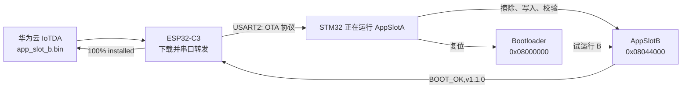

# STM32 A/B 分区 OTA 升级完整流程与问题排查手册

## 1. 文档目的

本手册记录本工程通过 **华为云 IoTDA + ESP32-C3 网关 + STM32F103ZET6** 完成 A/B 分区 OTA 升级的完整过程。

适用目标：

- 当前 STM32 正在运行 A 分区；
- 将新程序编译为 B 分区固件；
- 上传 B 的 `.bin` 到华为云；
- ESP32 从云端下载固件，并通过 USART2 转发给 STM32；
- STM32 写入 B，重启后由 Bootloader 启动 B；
- B 稳定运行后确认成功，ESP32 向华为云上报完成。

本工程的手写代码均应放在 `User` 目录或 CubeMX 的 `USER CODE BEGIN/END` 区域，重新生成 CubeMX 代码时不会丢失。

---

## 2. Flash 分区规划

芯片：STM32F103ZET6，Flash 为 512 KB，页大小为 2 KB。

| 区域 | 起始地址 | 大小 | 作用 |
|---|---:|---:|---|
| Bootloader | `0x08000000` | `0x7000`（28 KB） | 选择 A 或 B 并跳转 |
| OTA 元数据 | `0x08007000` | `0x1000`（4 KB） | 保存 active、pending、确认状态 |
| AppSlotA | `0x08008000` | `0x3C000`（240 KB） | 当前正常运行的应用 |
| AppSlotB | `0x08044000` | `0x3C000`（240 KB） | 云端升级写入的新应用 |



关键原则：**当前运行 A 时，只允许写 B；当前运行 B 时，只允许写 A。绝不覆盖正在运行的应用。**

---

## 3. 三个 Keil 工程的职责

| Keil 工程 | 链接地址 | 是否需要经常烧录 | 职责 |
|---|---:|---|---|
| `Bootloader.uvprojx` | `0x08000000` | 第一次或 Bootloader 改动时 | 上电选择并跳转应用 |
| `AppSlotA.uvprojx` | `0x08008000` | 初次安装 A 时 | 当前应用、接收升级、写入 B |
| `AppSlotB.uvprojx` | `0x08044000` | 不用 ST-Link 手动烧录 | 新版本应用，生成上传云端的 BIN |

不要把 `main.c` 或 App 文件加入 Bootloader 工程；也不要继续使用旧的混合 Target 工程来做 OTA。

### 3.1 A 与 B 的 Keil 宏

在 `Options for Target -> C/C++ -> Define` 中分别设置。

AppSlotA：

```text
OTA_APPLICATION_SLOT=OTA_SLOT_A
OTA_CURRENT_VERSION=\"v1.0.0\"
```

AppSlotB：

```text
OTA_APPLICATION_SLOT=OTA_SLOT_B
OTA_CURRENT_VERSION=\"v1.1.0\"
```

AppSlotA 的 IROM1：

```text
Start: 0x08008000
Size : 0x0003C000
```

AppSlotB 的 IROM1：

```text
Start: 0x08044000
Size : 0x0003C000
```

---

## 4. CubeMX 配置

### 4.1 USART2

ESP32 与 STM32 使用 USART2：

| STM32 | ESP32-C3 | 说明 |
|---|---|---|
| PA2 / USART2_TX | GPIO6 / RX | STM32 发送到 ESP32 |
| PA3 / USART2_RX | GPIO7 / TX | ESP32 发送到 STM32 |
| GND | GND | 必须共地 |

CubeMX 中 USART2 设置：

```text
Asynchronous
115200 baud
8 data bits
No parity
1 stop bit
No hardware flow control
开启 USART2 global interrupt
```

生成代码后，`stm32f1xx_it.c` 中必须存在：

```c
void USART2_IRQHandler(void)
{
    HAL_UART_IRQHandler(&huart2);
}
```

### 4.2 FreeRTOS OTA 任务

在 CubeMX：

```text
Middleware and Software Packs
→ FREERTOS
→ Tasks and Queues
→ Add
```

新增任务：

| 配置项 | 值 |
|---|---|
| Task Name | `otaTask` |
| Entry Function | `StartOtaTask` |
| Stack Size | `1024` Words（约 4 KB） |
| Priority | `AboveNormal` |

保持 `CMSIS_V2`，不要在已有工程中改为 V1。

在 CubeMX 的 `Project Manager -> Code Generator` 勾选：

```text
Keep User Code when re-generating
```

---

## 5. OTA 文件放置与 Keil 添加方法

OTA 核心文件放在工程中独立的用户目录：

```text
huanjing_HAL
└── User
    └── OTA
        ├── Inc
        └── Src
```

两个 App 工程都需要加入以下源文件：

```text
ota_app.c
ota_integrity.c
ota_metadata.c
ota_port.c
ota_storage.c
ota_uart.c
sha256.c
```

两个 App 工程都需要加入头文件路径：

```text
..\User\OTA\Inc
```

Bootloader 工程不加入以上应用 OTA 文件。

---

## 6. 最终正确的 USART2 接收结构

### 6.1 为什么不能让两个模块直接读取 USART2

错误做法：

```text
旧 ESP32 模块：HAL_UART_Receive_IT()
OTA 模块：HAL_UART_Receive()
```

两种 HAL 接收方式同时操作同一个 `huart2`，会使其中一个接收操作返回 Busy，造成数据收不到。

另一个错误做法是 OTA 任务每隔 1 ms 直接轮询 UART：

```c
OtaUart_Process();
osDelay(1);
```

115200 波特率下，1 ms 约有 11 个字节到达。STM32F103 UART 硬件缓存很小，任务延时期间会丢字节，因此 `STATUS,...` 和 OTA 二进制数据都不可靠。

### 6.2 最终正确做法：中断环形缓冲区

最终数据流必须是：

```text
ESP32
  ↓
USART2 接收中断
  ↓
esp32_uart.c 的 256 字节环形缓冲区
  ↓
otaTask / OtaUart_Process()
  ├─ STATUS,...  → LCD 状态模块
  └─ OTA 数据    → 写入非活动分区
```

`Esp32Uart_Init()` 只调用一次，推荐放在 `MX_FREERTOS_Init()` 的 `USER CODE BEGIN Init` 中：

```c
Esp32Status_Init();

/* 启动 USART2 中断接收，把 ESP32 数据写入环形缓冲区。 */
Esp32Uart_Init();

OtaApp_Init();
OtaUart_Init(OTA_APPLICATION_SLOT);
```

`Esp32Uart_Init()` 内部必须调用：

```c
HAL_UART_Receive_IT(&huart2, &g_rx_byte, 1U);
```

中断回调每收到一个字节，都要将字节写入环形缓冲区并立即重新开启下一字节接收。

### 6.3 OTA 从环形缓冲区取字节

`esp32_uart.h`：

```c
bool Esp32Uart_ReadByte(uint8_t *byte);
```

`esp32_uart.c`：

```c
bool Esp32Uart_ReadByte(uint8_t *byte)
{
    if ((byte == NULL) || (g_rx_read == g_rx_write))
    {
        return false;
    }

    *byte = g_rx_buffer[g_rx_read];
    g_rx_read = (uint16_t)((g_rx_read + 1U) % ESP32_UART_RX_BUFFER_SIZE);
    return true;
}
```

`User/OTA/Src/ota_port.c`：

```c
#include "esp32_uart.h"

bool OtaPort_ReadByte(uint8_t *byte)
{
    return Esp32Uart_ReadByte(byte);
}
```

### 6.4 uartTask 只发送 ENV，不读取数据

`StartTask03()` 中不能再调用旧的行接收处理器：

```c
旧行处理函数();
旧行读取函数(...);
```

因为这些函数也会从环形缓冲区取数据，导致 OTA 任务收到残缺的协议内容。

任务三只复制环境快照并发送 `ENV`。OTA 正在占用协议流时暂停上报：

```c
void StartTask03(void *argument)
{
    EnvData_t environment;
    (void)argument;

    for (;;)
    {
        RtosData_CopyEnvironment(&environment);
        if (RtosData_IsEnvironmentReady(&environment) && !OtaUart_IsBusy())
        {
            RtosData_SendEnvironment(&environment);
        }
        osDelay(1000);
    }
}
```

`STATUS`、`OTA_BEGIN`、二进制帧、`OTA_END` 和 `OTA_ABORT` 都由
`otaTask` 内的 `OtaUart_Process()` 统一消费。空闲时按换行解析文本；进入升级后，
除 `OTA_END`/`OTA_ABORT` 外的数据按二进制状态机解析。

---

## 7. OTA 任务的作用

`StartOtaTask()` 中需要持续执行：

```c
OtaUart_Process();
```

它自动识别并处理：

| ESP32 发来的内容 | STM32 动作 |
|---|---|
| `STATUS,...` | 更新 ESP32/WiFi/MQTT/OTA LCD 状态 |
| `OTA_BEGIN,...` | 检查目标槽位、擦除 B、回复 `OTA_READY` |
| 固件二进制帧 | CRC16 校验后写入 B，回复 `OTA_ACK,n` |
| `OTA_END` | 校验 SHA-256、向元数据写入 pending、回复 `OTA_OK` |

写入完成后 STM32 自动复位。B 启动并稳定运行 10 秒后，任务执行：

```c
OtaApp_ConfirmRunning(OTA_APPLICATION_SLOT);
```

然后发送：

```text
BOOT_OK,v1.1.0
```

ESP32 收到 `BOOT_OK` 后才向华为云上报：

```text
100% / installed
```

---

## 8. 编译 AppSlotB 并生成 BIN

打开：

```text
MDK-ARM\AppSlotB.uvprojx
```

确认 B 的版本是新版本，例如：

```text
OTA_CURRENT_VERSION=\"v1.1.0\"
```

编译后会得到：

```text
MDK-ARM\Objects\AppSlotB\app_slot_b.axf
```

打开 Windows PowerShell：

```powershell
cd D:\aiguigu\huanjing_freeRTOS_HAL\huanjing_HAL\MDK-ARM\Objects\AppSlotB
```

执行转换：

```powershell
& "C:\Keil_v5\ARM\ARMCLANG\bin\fromelf.exe" --bin --output ".\app_slot_b.bin" ".\app_slot_b.axf"
```

若使用旧版 ARMCC，可改为：

```powershell
& "C:\Keil_v5\ARM\ARMCC\bin\fromelf.exe" --bin --output ".\app_slot_b.bin" ".\app_slot_b.axf"
```

上传华为云的文件只能是：

```text
app_slot_b.bin
```

不要上传 `.axf`、`.hex` 或 `.elf`。

检查 BIN 大小：

```powershell
(Get-Item .\app_slot_b.bin).Length
```

当前 OTA 协议要求文件长度为偶数。

计算 SHA-256：

```powershell
Get-FileHash .\app_slot_b.bin -Algorithm SHA256
```

SHA-256 必须与云端下发固件的 `sign` 字段一致。

---

## 9. ESP32 与华为云配置

配置文件：

```text
portable_ota\esp32c3_arduino_gateway\esp32c3_ota_gateway\ota_gateway_config.h
```

必须填写真实信息：

```cpp
#define OTA_WIFI_SSID              "你的WiFi名称"
#define OTA_WIFI_PASSWORD          "你的WiFi密码"
#define OTA_IOTDA_HOST             "你的IoTDA地址"
#define OTA_IOTDA_DEVICE_ID        "你的设备ID"
#define OTA_IOTDA_CLIENT_ID        "你的客户端ID"
#define OTA_IOTDA_PASSWORD         "你的设备密钥"

/* 此值必须与当前运行中的 A 版本一致。 */
#define OTA_STM32_FIRMWARE_VERSION "v1.0.0"
```

填完后用 Arduino IDE 重新烧录 ESP32-C3。

Arduino IDE 串口监视器使用：

```text
115200 baud
```

---

## 10. 华为云上传 B 并下发升级任务

1. 进入华为云 IoTDA 的“设备 > 软固件升级 > 固件列表”。
2. 上传 `app_slot_b.bin`。
3. 固件版本填写新版本，例如 `v1.1.0`。
4. 校验值填写本地计算得到的 SHA-256。
5. 自定义信息填写：

   ```text
   slot=B
   ```

6. 创建 OTA 升级任务。
7. 选择 ESP32 对应的云端设备。
8. 下发升级任务。

`slot=B` 很重要：ESP32 网关和 STM32 都会据此确认新固件应写入 B，而不是覆盖当前 A。

---

## 11. 一次正常升级时的现象

```text
华为云下发 v1.1.0 升级任务
        ↓
ESP32 显示 ota_start，进度 0%
        ↓
ESP32 → STM32：OTA_BEGIN,v1.1.0,B,size,sha256
        ↓
STM32 → ESP32：OTA_READY
        ↓
ESP32 发送二进制帧
STM32 → ESP32：OTA_ACK,0 / OTA_ACK,1 / ...
        ↓
STM32 → ESP32：OTA_OK
        ↓
STM32 短暂黑屏并自动复位
        ↓
Bootloader 跳转 B（0x08044000）
        ↓
B 稳定运行 10 秒
        ↓
STM32 → ESP32：BOOT_OK,v1.1.0
        ↓
华为云显示 100% / installed
```

### 11.1 如何判断当前已经运行 B

最可靠的判断是华为云 OTA 任务显示：

```text
100% / installed
```

这表示 ESP32 已收到 `BOOT_OK,v1.1.0`，即 B 已经启动并完成确认。

当前 LCD 页面默认不显示 A/B 槽位和版本号，因此“黑屏一下”不是成功凭证。建议后续在 OTA 页面增加：

```text
APP SLOT : B
VERSION  : v1.1.0
```

---

## 12. 本次遇到的问题、原因与最终解决方案

| 现象 | 实际原因 | 最终解决方案 |
|---|---|---|
| LCD 显示 `ESP32 : WAITING` | STM32 没有获得完整 `STATUS,...` 行 | USART2 中断环形缓冲区收数据，OTA 任务统一解析 |
| `0%` 后很快变回 `ready` | ESP32 没等到 STM32 的 `OTA_READY`，通常是 STM32 串口接收失败 | 确保 `Esp32Uart_Init()` 已执行，且 OTA 从环形缓冲区取数据 |
| 同时使用 `HAL_UART_Receive_IT` 和 `HAL_UART_Receive` | 同一 `huart2` 被两种接收方式竞争，出现 Busy | 只保留“中断写入环形缓冲区”这一种底层接收方式 |
| OTA 任务每 1 ms 轮询 UART 仍丢数据 | 115200 下 1 ms 到达多个字节，硬件缓存溢出 | 使用中断接收；任务从软件缓冲区批量取数据 |
| `uarttask` 调用旧行读取接口 | uartTask 与 otaTask 同时消费同一缓冲区 | uartTask 不读取 USART2，全部由 otaTask 处理 |
| ESP32 状态始终等待 | 忘记调用 `Esp32Uart_Init()`，中断接收没有启动 | 在 `MX_FREERTOS_Init()` 的 Init 用户代码区调用一次 |
| 云端无法连接 | `ota_gateway_config.h` 仍为 `CHANGE_ME` | 填写 WiFi、IoTDA 地址、设备 ID、客户端 ID、设备密钥 |
| 升级后短暂黑屏 | STM32 收到 `OTA_OK` 后复位，LCD 重新初始化 | 等待 10～15 秒，查看 B 的 `BOOT_OK` 和云端 100% |
| 云端停在 99% / rebooting | B 未启动、崩溃或未完成 10 秒确认 | 检查 B 链接地址、B 的任务是否运行、是否发送 `BOOT_OK` |
| 注释显示 `?` 或乱码 | 工程文件混用了损坏 UTF-8 与 GBK 编码 | 所有已处理源文件统一为 UTF-8 with BOM |

---

## 13. 常用故障定位顺序

遇到问题时按下面顺序检查，避免一次改多个地方。

1. 看 STM32 LCD 是否从 `WAITING` 变为 `CONNECTED`。
2. 看 Arduino IDE 串口监视器是否有 `[Gateway]` 状态日志。
3. 确认 `Esp32Uart_Init()` 已在 FreeRTOS 初始化阶段调用。
4. 确认 `uarttask` 没有调用任何 UART 接收接口，只负责发送 ENV。
5. 确认 `ota_port.c` 使用 `Esp32Uart_ReadByte()`，不直接 `HAL_UART_Receive()`。
6. 确认当前运行 A 时，云端自定义信息为 `slot=B`。
7. 确认上传的是 `app_slot_b.bin`，而不是 AXF 或 HEX。
8. 确认 SHA-256、文件大小、云端版本与 BIN 完全对应。
9. 看云端任务状态：`0%`、`99%`、`100%` 分别停在哪一步。

---

## 14. 日常升级操作清单

以后每次升级 B，可按以下清单执行：

- [ ] 当前设备运行 A，且 ESP32/WiFi/MQTT 状态正常。
- [ ] 修改 B 的业务代码与 `OTA_CURRENT_VERSION`。
- [ ] 使用 `AppSlotB.uvprojx` 编译。
- [ ] 使用 `fromelf` 生成 `app_slot_b.bin`。
- [ ] 计算 BIN 的 SHA-256。
- [ ] 上传 BIN 到华为云，版本填写新版本。
- [ ] 自定义信息填写 `slot=B`。
- [ ] 创建并下发升级任务。
- [ ] 查看 ESP32 日志是否收到 `OTA_READY`、`OTA_ACK`、`OTA_OK`。
- [ ] 等待重启后的 `BOOT_OK`。
- [ ] 确认华为云显示 `100% / installed`。

当设备已经运行 B、需要升级回 A 时，流程相同，只需将云端自定义信息改为：

```text
slot=A
```
