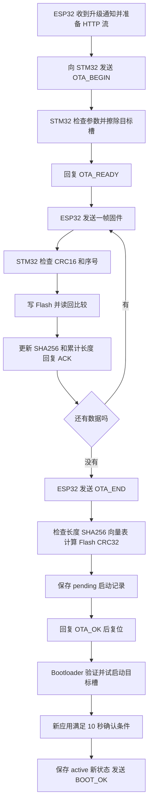

> 当前主工程已精简：本文中的 ota_cloud 解析模块仅保留于 portable_ota；ForTest 辅助函数已移至 tests/test_ota_uart_compile.c；闲置的 OtaApp_ResetToBootloader 已移除。最新阅读入口见同目录《OTA入门_跟着一次升级读代码.md》。

# STM32 OTA Src 源码详解

这份文档围绕本工程 `huanjing_HAL/user/OTA/Src` 中的 8 个 C 文件，解释 ESP32 发来的固件数据如何进入 STM32、如何写入另一个应用槽、如何验证完整性，以及复位后如何试运行和确认新固件。阅读目标是：看到一个函数时，能说清楚它由谁调用、操作什么数据、为什么需要这一步、失败后会发生什么。

讲解对应 2026 年 9 月 18 日工作区源码。所有地址、长度和状态转换均按当前实现说明。示例中默认 A 槽正在运行、准备升级 B 槽；反向升级的原理相同。本文中的“稳定运行 10 秒”是当前代码采用的确认条件，不代表已经完成传感器、屏幕、网络等功能的全面健康检测。

**先记住主线：串口接收的是字节，协议层把字节组成帧，应用层把帧内的固件内容写进 Flash，元数据层告诉 Bootloader 下次尝试哪个槽。新固件启动后再确认，才正式取代旧固件。**

本文使用 Markdown。流程图支持 Mermaid；即使阅读器不显示图形，图下的文字和代码流程也能独立阅读。源码定位集中在文末，行号以本次文档生成时的源码为准。

## 阅读目录

1. [先弄清整个工程的分工](#chapter-1)
2. [看懂 Flash 布局和几个关键名词](#chapter-2)
3. [八个源码文件各负责什么](#chapter-3)
4. [从 FreeRTOS 任务追到 OTA 入口](#chapter-4)
5. [ota_uart.c 如何接收命令和 bin 数据](#chapter-5)
6. [ota_app.c 如何把固件安全写入 Flash](#chapter-6)
7. [ota_metadata.c 如何描述启动状态](#chapter-7)
8. [ota_storage.c 如何把启动状态保存到 Flash](#chapter-8)
9. [ota_integrity.c 如何判断数据和入口是否合理](#chapter-9)
10. [sha256.c 如何分块计算整包摘要](#chapter-10)
11. [ota_port.c 如何连接协议层与具体硬件](#chapter-11)
12. [ota_cloud.c 的解析逻辑和当前使用位置](#chapter-12)
13. [完整走一遍从 A 升级到 B](#chapter-13)
14. [常见错误和当前实现的边界](#chapter-14)
15. [建议怎样打断点和阅读源码](#chapter-15)
16. [用问题检查自己是否读懂](#chapter-16)
17. [全部函数源码定位索引](#chapter-17)

<a id="chapter-1"></a>

## 1 先弄清整个工程的分工

### 1.1 三个程序在配合

这套升级不是一个程序从头执行到尾，而是三个程序接力：

| 程序 | 运行在哪里 | 核心任务 |
|---|---|---|
| ESP32 网关程序 | ESP32-C3 | 收到云端通知、HTTP 下载固件、通过串口分帧交给 STM32、上报进度 |
| STM32 应用程序 | STM32 的 A 或 B 槽 | 正常运行业务，同时接收固件并写入另一个槽 |
| Bootloader | STM32 Flash 最前面的独立区域 | 复位后读取启动记录、检查候选固件、选择并跳转到应用 |

`OTA/Src` 主要包含 STM32 应用侧的 OTA 实现，以及应用和 Bootloader 可以共用的完整性校验、启动记录、Flash 存储逻辑。Bootloader 的选槽与跳转主体在目录外的 `boot_main.c` 中。

当前串口接收方案是 **ESP32 Arduino 网关 + 自定义 UART 帧协议**。看到某些旧注释提到 ESP-AT 或 HTTP Range 时，不要据此认为 STM32 正在发送 AT 指令下载文件。当前实际链路中，HTTP 下载由 ESP32 完成。

### 1.2 一次升级经历哪些阶段



这里最重要的分界是：**下载完成、允许试启动、试启动成功，是三件不同的事。**

- 收到最后一帧：只说明数据阶段结束，还没有完成最后验证。
- 返回 `OTA_OK`：说明整包处理成功，pending 记录已保存，可以准备试启动。
- 新应用发送 `BOOT_OK,版本`：说明新应用已经执行确认逻辑，并成功保存新的 active 状态。

### 1.3 为什么不直接覆盖正在运行的程序

假设 CPU 目前执行 A 槽中的指令。如果边运行边擦掉 A 槽，后续取指可能读到空白或不完整内容，程序会立刻失去正常运行的基础。因此当前实现强制：A 运行时写 B，B 运行时写 A。

旧槽保留还有另一个作用：下载失败或新程序启动不成功时，Bootloader 仍有一个可回退的旧版本。这里的“可回退”依赖旧固件本身仍然有效，以及系统能够再次复位进入 Bootloader。

<a id="chapter-2"></a>

## 2 看懂 Flash 布局和几个关键名词

### 2.1 当前配置的地址分布

地址来自 `ota_port_config.h`，由 `ota_layout.h` 提供给各模块。下表的结束地址采用“包含最后一个字节”的写法。

| 区域 | 起始地址 | 最后一个字节地址 | 容量 |
|---|---|---|---|
| Bootloader | `0x08000000` | `0x08006FFF` | 28 KiB |
| 元数据记录 A 所在页 | `0x08007000` | `0x080077FF` | 2 KiB |
| 元数据记录 B 所在页 | `0x08007800` | `0x08007FFF` | 2 KiB |
| 应用槽 A | `0x08008000` | `0x08043FFF` | 240 KiB |
| 应用槽 B | `0x08044000` | `0x0807FFFF` | 240 KiB |

总共是 512 KiB。一个 Flash 页为 `0x800`，即 2048 字节。两个应用槽大小都是 `0x3C000`，即 245760 字节。

源码中的 `OTA_SLOT_A_END` 等宏表示“起始地址 + 长度”，是排他的上界。例如 A 槽的上界是 `0x08044000`，这个地址已经属于 B 槽。

**应用槽 A/B 和元数据页 A/B 是两组不同的东西。** 应用槽存几十至几百 KiB 的机器码；元数据页只在页首存一条 32 字节启动记录。元数据页的 A/B 不代表“专门记录 A 应用”和“专门记录 B 应用”，它们是同一种记录的交替保存位置。

### 2.2 四个槽位相关变量不能混为一谈

| 名称 | 存在哪里 | 含义 |
|---|---|---|
| `running_slot` | 应用 RAM 状态 | 这一次实际正在执行哪个应用槽 |
| `target_slot` | 下载 RAM 状态 | 这一次固件准备写到哪个槽 |
| `active_slot` | Flash 启动记录 | 已确认可以作为稳定版本启动的槽 |
| `pending_slot` | Flash 启动记录 | 已下载验证完成，但尚未被新应用确认的槽 |

例如：A 正在给 B 下载时，`running=A`、`target=B`、`active=A`。下载结束后才登记 `pending=B`。复位试启动 B 后，`running=B`，但 `active` 仍是 A；等 B 确认成功，才改成 `active=B`、`pending=NONE`。

因此，“当前运行槽”和“已确认稳定槽”在新固件试运行期间可以不同。

### 2.3 bin 在这个工程里是什么

bin 是应用固件的原始字节内容。当前链路并不把它存成 FATFS 中的一个文件，也不传输文件名。ESP32 告诉 STM32 总长度、目标槽、版本和摘要，再连续发送内容。STM32 把第 0 个内容字节写到目标槽首地址，把后面的内容按偏移继续写下去。

应用 bin 开头的两个 32 位值通常来自向量表：

```text
目标槽首地址 + 0  初始主栈指针 MSP
目标槽首地址 + 4  Reset_Handler 入口地址
目标槽首地址 + 8  后续异常和中断向量
```

bin 本身不会自动把所有绝对地址改成另一槽地址。写入 B 槽的镜像必须按 B 槽地址链接，并采用正确的应用槽宏和向量表设置。不能因为两个槽容量一样，就把为 A 链接的 bin 原样当作 B 镜像。

### 2.4 RAM 状态与 Flash 状态的区别

`g_ota_uart`、`g_ota_app` 是 RAM 中的静态结构体。静态意味着跨函数调用一直存在，不意味着掉电后保留。复位后它们会重新初始化。

`OtaBootRecord_t` 是一种结构体格式；当它通过 `OtaStorage_Save()` 写进元数据页后，记录内容才可以跨复位保留。Bootloader 和新应用正是依靠这条持久化记录接力。

<a id="chapter-3"></a>

## 3 八个源码文件各负责什么

| 文件 | 主要输入 | 主要输出或副作用 | 可以这样理解 |
|---|---|---|---|
| `ota_uart.c` | 串口字节流 | 解析命令和帧、调用应用写入、发送应答 | 协议接收员 |
| `ota_app.c` | 目标槽、长度、摘要、连续数据块 | 擦写固件、校验、生成 pending、确认 active | 升级流程执行者 |
| `ota_metadata.c` | 启动记录结构体 | 检查记录、构造记录、选择新记录 | 启动状态规则 |
| `ota_storage.c` | 启动记录及固定 Flash 地址 | 读取和交替写入两页元数据 | 启动状态存储驱动 |
| `ota_integrity.c` | 字节、长度、向量表前两个字 | CRC32、长度是否合法、入口是否合法 | 公共检查工具 |
| `sha256.c` | 顺序输入的固件内容 | 32 字节摘要及十六进制比较结果 | 整包摘要计算器 |
| `ota_port.c` | 读字节、发数据、复位、状态行请求 | 调用板级 UART 和业务接口 | 板卡适配层 |
| `ota_cloud.c` | 受限格式的云端 JSON | 事件结构体或上报 JSON | 云协议辅助模块 |

建议不要按文件名字母顺序硬读。先看 `ota_uart.c → ota_app.c`，再看 `ota_metadata.c → ota_storage.c`，最后回头看校验和适配工具。

```text
应用接收路径
StartOtaTask
  -> OtaUart_Process
       -> OtaPort_ReadByte -> Esp32Uart_ReadByte
       -> OtaUart_PushLineByte / OtaUart_PushFrameByte
       -> OtaApp_Begin / OtaApp_Write / OtaApp_Finalize
            -> Sha256_...
            -> Ota_Crc32 / Ota_VectorWordsAreValid
            -> OtaRecord_... -> OtaStorage_...

复位后的选槽路径
Bootloader_SelectSlot
  -> OtaStorage_Load
       -> OtaRecord_SelectNewest -> OtaRecord_IsValid
  -> 检查 pending 固件
  -> 先保存尝试次数，再启动 pending

新应用确认路径
RtosOta_ConfirmWhenStable
  -> OtaApp_IsConfirmationRequired
  -> OtaApp_ConfirmRunning -> OtaStorage_Save
  -> OtaPort_Send("BOOT_OK,...")
```

`ota_cloud.c` 不在上面这条 STM32 接收调用链中。当前提供的 ESP32 网关使用自己的 `HuaweiIotda::handleMqttMessage()` 和 ArduinoJson 解析云消息。这个差别在第 12 章详细解释。

<a id="chapter-4"></a>

## 4 从 FreeRTOS 任务追到 OTA 入口

### 4.1 初始化发生在任务创建之前

`MX_FREERTOS_Init()` 的相关调用顺序是：

```c
Esp32Status_Init();
Esp32Uart_Init();
OtaApp_Init();
OtaUart_Init(OTA_APPLICATION_SLOT);
```

`Esp32Uart_Init()` 清空串口环形缓冲区读写索引，然后执行：

```c
HAL_UART_Receive_IT(&huart2, &g_rx_byte, 1U);
```

这句话要求 HAL 通过中断接收一个字节，放入 `g_rx_byte`。它不是一次收整份 bin，也不是 DMA 接收整帧。

`OtaApp_Init()` 清空固件写入上下文。`OtaUart_Init()` 清空协议上下文，记录当前编译目标对应的运行槽，并将帧解析状态设成等待帧头。

### 4.2 中断只搬运字节

USART2 收到字节后，通过 HAL 的中断处理进入 `HAL_UART_RxCpltCallback()`。回调确认来源是 USART2，然后把 `g_rx_byte` 放入环形缓冲区，最后重新执行一次单字节 `HAL_UART_Receive_IT()`。

```text
ESP32 TX
  -> STM32 USART2 RX
  -> USART2_IRQHandler
  -> HAL_UART_IRQHandler
  -> HAL_UART_RxCpltCallback
  -> g_rx_buffer
```

环形缓冲区数组长 256 字节，使用“下一写位置等于读位置则认为满”的方案，因此实际最多存 255 个未消费字节。满时当前实现丢弃新收到的字节。

中断里没有做 CRC、没有擦 Flash、没有调用 `OtaApp_Write()`。这些操作耗时更长，放进中断会影响其他中断和任务的及时执行。

### 4.3 OTA 任务不断消费缓冲区

`StartOtaTask()` 的核心逻辑是：

```c
boot_time = HAL_GetTick();
for (;;) {
    OtaUart_Process();
    if (!confirmed && RtosOta_ConfirmWhenStable(boot_time)) {
        confirmed = true;
    }
    osDelay(1);
}
```

`OtaUart_Process()` 中的 `while (OtaPort_ReadByte(&byte))` 会一直读到当前缓冲区为空。即使本次只拿到半帧，下次调用仍可以从保存的 `frame_state` 继续解析。

这里所谓非阻塞，准确地说是“读不到字节时不等待未来数据”。整个 `OtaUart_Process()` 仍可能因为处理完整命令或数据帧而同步擦写 Flash、计算整包 CRC、发送 UART 应答，所以不能理解成每次调用都立即返回。

### 4.4 为什么环形缓冲区小于一帧仍能工作

最大帧为 512 字节固件内容加 8 字节协议开销，共 520 字节。环形缓冲区不需要同时容纳整帧，因为任务会在字节到达的过程中不断把它们取走，并复制进 `g_ota_uart.payload`。

但前提是消费足够及时。当前 115200、8N1 的串口每字节占 10 个线路位，连续输入约为 11520 字节/秒。255 字节空余缓存大约只能容纳 22.1 ms 的连续输入；520 字节帧的线路时间约 45.1 ms。这是理论值，不含调度和处理开销。该估算帮助理解为什么 OTA 任务要频繁运行，也说明不能把小缓冲区理解成可无限吸收串口流量。

<a id="chapter-5"></a>

## 5 ota_uart.c 如何接收命令和 bin 数据

这是“接收 ESP 发来的 bin”最直接对应的文件。它处理协议，不直接在状态机里编写 HAL Flash 擦写细节。

### 5.1 g_ota_uart 保存什么

| 字段 | 用途 | 一次传输中的典型变化 |
|---|---|---|
| `running_slot` | 当前程序在哪个槽 | 初始化为 A，整个下载过程保持 A |
| `busy` | 是否已进入固件接收阶段 | false → BEGIN 成功后 true → END 或 ABORT 后 false |
| `expected_sequence` | 下一帧应当使用的序号 | 0、1、2…… |
| `written_size` | 协议层认为已成功提交的总字节数 | 0、512、1024…… |
| `frame_state` | 当前等待帧中的哪种字节 | 帧头 → 序号 → 长度 → 内容 → CRC |
| `received_sequence` | 当前帧携带的序号 | 收到两个字节后拼成 16 位整数 |
| `received_length` | 当前帧声明的内容长度 | 必须为 1 至 512 范围内的偶数 |
| `received_crc` | 当前帧尾声明的 CRC16 | 低字节、高字节拼接 |
| `payload_index` | 已收到多少个内容字节 | 0 一直加到 `received_length` |
| `payload[512]` | 当前帧的固件内容 | 收满一帧后交给写入层 |
| `line[160]` 和 `line_length` | 当前尚未结束的文本命令 | 收到换行才处理 |
| `reading_control_line` | 当前是否正在拼文本行 | 在二进制帧之间识别到命令时置 true |
| `reset_pending` | 已成功收尾，处理循环末尾需要复位 | 收到有效 END 后置 true |
| `message[32]` | 最近的简短状态 | 如 `OTA receiving`、`OTA verify error` |

这些字段让状态机可以跨多次任务调用继续工作。`static OtaUartState_t g_ota_uart` 的作用是保存上下文，不是保存整份文件。

### 5.2 OtaUart_Process 如何分流

核心条件只有这一处：

```c
if (g_ota_uart.reading_control_line || !g_ota_uart.busy) {
    OtaUart_PushLineByte(byte);
} else {
    OtaUart_PushFrameByte(byte);
}
```

读法是：没有开始升级时，默认按文本处理；升级中通常按二进制帧处理；如果已经识别到一条控制行，则先把这条控制行拼完。

`busy` 不表示串口上有没有任何数据，而表示当前协议处于哪一个大阶段。因此即使没有固件升级，串口仍可以传 `STATUS,...` 状态行。

### 5.3 文本行如何收齐

`OtaUart_PushLineByte()` 有四种行为：

1. 收到 `\n`：在末尾补 `\0`，使缓冲区成为 C 字符串，然后调用 `OtaUart_HandleControlLine()`。
2. 收到 `\r`：忽略它，所以 `\r\n` 与单独 `\n` 都能作为行结尾。
3. 普通字节且还有位置：保存到 `line`，增加 `line_length`。
4. 行太长：清空本行长度、退出控制行状态、设置 `OTA line too long`。此分支没有直接向 ESP32 发送专门错误响应。

为什么要补 `\0`？因为 `strcmp`、`strncmp`、`sscanf` 等 C 字符串函数以零字节识别字符串结尾，而串口命令以换行结束，两者需要转换。

### 5.4 OTA_BEGIN 如何进入下载状态

命令形状是：

```text
OTA_BEGIN,v1.2.1,B,1536,<64个十六进制SHA256字符>\r\n
```

这里的尖括号部分是解释性占位符，实际必须发送真实的 64 字符摘要。`OtaUart_HandleBegin()` 用下面的格式读取四个字段：

```c
sscanf(line, "OTA_BEGIN,%31[^,],%1[A-B],%lu,%64s",
       version, slot_text, &file_size, sha256)
```

- `%31[^,]`：读最多 31 个非逗号字符作为版本。
- `%1[A-B]`：只读取一个 A 或 B 字符。
- `%lu`：读取文件大小。
- `%64s`：读取最多 64 个非空白字符作为 SHA256 文本。
- 返回值必须是 4，说明四个字段都取得了值。

随后检查版本字符、文件大小是否为非零偶数、是否超过槽容量、摘要字符是否为十六进制。摘要中的大写 A 至 F 会转换成小写，以适配后续摘要比较。

上述检查失败就回复 `OTA_ERROR,begin`，不会执行擦除。接着调用：

```c
OtaApp_Begin(g_ota_uart.running_slot, target_slot,
             (uint32_t)file_size, sha256);
```

应用层进一步检查目标槽是否为另一槽、是否已有下载在进行，并擦除目标页。这个调用失败，协议层统一回复 `OTA_ERROR,slot`。因此看到 `slot` 不一定只是槽编号错误，也可能是擦除或其他 Begin 阶段错误。

只有 `OtaApp_Begin()` 成功，协议层才将 `busy=true`、序号和累计长度清零，复位帧解析状态，最后回复 `OTA_READY`。ESP32 必须等 READY，再开始发送固件帧。

版本字符串在这里用于格式校验，当前接收结构体没有保存目标版本，也没有将它写入启动记录。最终 `BOOT_OK` 使用的是新应用自身编译进去的 `OTA_CURRENT_VERSION`。

### 5.5 一帧到底长什么样

| 帧内位置 | 长度 | 含义 |
|---|---|---|
| 0 | 1 字节 | `0xA5` |
| 1 | 1 字节 | `0x5A` |
| 2 至 3 | 2 字节 | 帧序号，小端 |
| 4 至 5 | 2 字节 | 固件内容长度，小端 |
| 6 开始 | N 字节 | bin 内容，不包含文件名 |
| 6+N 至 7+N | 2 字节 | CRC16，小端 |

总长度为 `N + 8`。例如 512 的十六进制是 `0x0200`，在线路上长度字段发送 `00 02`；帧序号 1 发送 `01 00`。这就是小端：低 8 位先传。

CRC16 的覆盖范围是 **序号 + 长度 + 内容**，不包括 `A5 5A` 和 CRC 字段自身。它既保护内容，也保护序号和长度字段。

下面仅为帧格式示例，4 字节内容不是可启动的完整镜像：

```text
A5 5A | 00 00 | 04 00 | 11 22 33 44 | CRC低 CRC高
 帧头    序号0    长度4      内容          帧校验
```

### 5.6 OtaUart_PushFrameByte 的九个状态

| 当前状态 | 收到字节后的动作 | 下一步 |
|---|---|---|
| `WAIT_SYNC_1` | 等 `A5`；若遇到字符 O 则转去接收控制行 | `WAIT_SYNC_2` 或文本解析 |
| `WAIT_SYNC_2` | 必须是 `5A` | 正确进入序号；错误回到等帧头 |
| `READ_SEQUENCE_LOW` | 保存序号低 8 位 | 等序号高位 |
| `READ_SEQUENCE_HIGH` | 高字节左移 8 位后合并 | 等长度低位 |
| `READ_LENGTH_LOW` | 保存长度低 8 位 | 等长度高位 |
| `READ_LENGTH_HIGH` | 合并长度，检查非零、≤512、偶数 | 合法则开始收内容，否则重置 |
| `READ_PAYLOAD` | 存入 `payload[payload_index++]` | 收够 N 字节后等 CRC |
| `READ_CRC_LOW` | 保存 CRC 低 8 位 | 等 CRC 高位 |
| `READ_CRC_HIGH` | 合并 CRC，自行计算并比较 | 正确则提交该帧，错误回复 NACK，然后重置 |

关键的拼数写法是：

```c
received_sequence = low;
received_sequence |= (uint16_t)high << 8U;
```

例如低字节 `0x34`、高字节 `0x12`，结果为 `0x1234`。先转成 `uint16_t` 再移位，明确表达“我要拼一个 16 位值”。

**为什么 bin 中出现换行、逗号或字母 O 不会破坏协议？** 因为在 `READ_PAYLOAD` 状态中，所有字节都按数据保存，不执行文本识别。只有在等待新帧头时遇到 O，才认为可能是 `OTA_END` 或 `OTA_ABORT`。

如果半帧已经开始但没有收完，直接发送 `OTA_ABORT` 不保证立刻中止：这些字节可能还会被当作这帧剩余的内容或 CRC。这个实现没有独立的半帧超时恢复机制。

### 5.7 CRC16 具体怎么检查

`OtaUart_Crc16()` 的初始值是 `0xFFFF`，使用反射形式多项式 `0xA001`，与 ESP32 端的 CRC16/MODBUS 算法一致。

对于每个输入字节，先与当前 CRC 做异或，再执行 8 次右移。如果移位前最低位为 1，就在右移结果上异或 `0xA001`。重复直到所有字节都处理完。

该函数每次调用都会从初始值重新开始，接口不接受上次 CRC 状态。因此不能分别算头和内容，再把两个结果简单拼接。源码会先建立 `crc_data[4 + 512]`，按相同的小端形式写入序号、长度，再附上内容，一次计算。

CRC 不匹配时回复 `OTA_NACK,expected_sequence`，不调用 Flash 写入，不更新累计长度，然后等待下一帧。

### 5.8 AcknowledgeFrame 为什么先写入再 ACK

核心逻辑是：

```c
if ((received_sequence != expected_sequence) ||
    (OtaApp_Write(written_size, payload, received_length) != HAL_OK)) {
    // 回复 OTA_NACK，状态不前进
    return;
}
written_size += received_length;
// 回复 OTA_ACK，携带本帧序号
expected_sequence++;
```

逻辑或 `||` 有短路性质。如果序号不对，根本不会调用 `OtaApp_Write()`。因此重复帧和乱序帧不会被直接交给下一段地址写入。

ACK 在成功写入并读回比较之后发送。所以它的含义比“串口收到了”更强：这一块固件已经由写入层确认成功。ESP32 收到本帧对应的 ACK，才继续下一帧，这是逐帧等待确认的发送方式。

同时也要注意其具体边界：ACK 的发送接口不返回结果给这里。假如 Flash 已写成功，但 ACK 丢失，STM32 已经推进到下一序号；ESP32 重发旧序号时，当前实现回复的是下一序号 NACK，并没有专门对“已写成功的上一帧”重复 ACK。因此不能把它说成对所有 ACK 丢失情况都能自动恢复。

### 5.9 OTA_END 和 OTA_ABORT 分别做什么

`OtaUart_HandleControlLine()` 在空闲阶段只处理 `OTA_BEGIN` 和 `STATUS`。在升级阶段则识别 `OTA_END`、`OTA_ABORT`。

收到 `OTA_END` 时：

1. 调用 `OtaApp_Finalize()` 做最终验证并保存 pending。
2. 成功则清除协议 busy，设置状态文本，发送 `OTA_OK`，置 `reset_pending=true`。
3. 失败则调用 `OtaApp_Abort()` 清空写入 RAM 状态，清除协议 busy，回复 `OTA_ERROR,verify`。
4. 两种情况都会复位帧状态。

`reset_pending` 在 `OtaUart_Process()` 读字节循环结束后检查，随后调用 `OtaPort_ResetToBootloader()`。**代码可以在处理 END 的同一次 Process 调用末尾复位，并没有强制再等下一轮任务。** 注释提到的“下一次处理尾部”不应理解成存在一个明确延时计时器。

收到 `OTA_ABORT` 时：清空应用下载上下文、结束协议接收状态、重置帧状态、回复 `OTA_ERROR,abort`。已经写到非运行槽里的字节不会被自动擦掉；关键是此次中止不会新建一个允许试启动的 pending 记录。

### 5.10 其余辅助函数怎样理解

| 函数 | 作用 |
|---|---|
| `OtaUart_WriteLe16` | 将一个 16 位数拆成低字节、高字节 |
| `OtaUart_ReadLe16` | 将低字节、高字节组合为 16 位数 |
| `OtaUart_SendLine` | 有界格式化文本并补 `\r\n`，调用适配层发送 |
| `OtaUart_SendSequenceResponse` | 统一生成 `OTA_ACK,n` 或 `OTA_NACK,n` |
| `OtaUart_SetMessage` | 更新固定长度状态文本 |
| `OtaUart_ResetFrame` | 回到等帧头，并清空内容索引和当前长度；不会重置整个下载 |
| `OtaUart_VersionIsSafe` | 限制版本使用字母、数字、点、下划线、横杠 |
| `OtaUart_NormalizeSha256` | 检查 64 位十六进制文本，并统一成小写 |
| `OtaUart_IsBusy` | 向业务层提供当前下载状态 |
| `OtaUart_GetLastMessage` | 返回内部状态字符串指针；调用者不应释放或改写 |
| `OtaUart_BuildFrameForTest` | 为主机测试构造帧，检查指针、内容长度和输出容量 |
| `OtaUart_FrameIsValidForTest` | 检查完整帧的头、总长度和 CRC |

`OTA_UART_HOST_TEST` 用于编译条件选择：定义后排除依赖 HAL 和板级硬件的主体，保留可在电脑上测试的帧基础函数。测试辅助函数没有完整覆盖运行状态机，例如它们没有像实际接收路径那样要求内容长度必须为偶数。因此“帧基础测试通过”不等于整套硬件 OTA 已验证。

<!-- FUNCTIONS_5_BEGIN -->

### 本文件全部函数总结

本表覆盖 `ota_uart.c` 中的全部 20 个函数，包括内部辅助函数。功能说明对应本章前面的详细流程。

| 函数 | 功能与调用时机 |
|---|---|
| `OtaUart_WriteLe16` | 将一个 16 位整数拆成低字节在前的两个字节。构造测试帧及重新拼 CRC 输入头时使用；写入调用者提供的 2 字节数组。 |
| `OtaUart_ReadLe16` | 把小端排列的两个字节合成为 16 位整数。测试帧验证读取长度和 CRC 时使用；不改变输入数据。 |
| `OtaUart_Crc16` | 从 0xFFFF 开始计算 CRC16/MODBUS。发送构帧和接收校验都按同样规则处理序号、长度和内容；返回 16 位校验值。 |
| `OtaUart_BuildFrameForTest` | 给电脑测试构造完整二进制帧，依次写帧头、序号、长度、内容和 CRC。容量或参数不满足要求返回 0，成功返回整帧字节数；此辅助函数不单独限制偶数长度。 |
| `OtaUart_FrameIsValidForTest` | 给电脑测试检查完整帧的帧头、内容长度、总帧长和 CRC。返回真假；不执行逐字节状态机，不写 Flash，也不检查业务层的全部约束。 |
| `OtaUart_SendLine` | 把短响应文本格式化成带回车换行的行，再交 OtaPort_Send 发送。空指针或输出超出内部缓冲区时不发送；自身不向调用者返回发送成功与否。 |
| `OtaUart_SendSequenceResponse` | 统一拼接响应名称与序号，如 OTA_ACK,0 或 OTA_NACK,1，再调用 SendLine。帧成功或拒绝时使用，避免不同分支生成不同应答格式。 |
| `OtaUart_SetMessage` | 以有界格式化方式更新模块中的最近状态文本。状态变化或失败分支调用，便于界面和调试读取；不发送串口消息。 |
| `OtaUart_ResetFrame` | 把解析状态恢复到等待第一个帧头，并清空当前内容长度和索引。每帧结束或异常后调用；不清本次下载的累计写入量和下一期望序号。 |
| `OtaUart_VersionIsSafe` | 检查版本字符串非空，且仅使用字母、数字、点、横杠和下划线。BEGIN 参数校验时调用；只验证字符，不比较新旧版本。 |
| `OtaUart_NormalizeSha256` | 检查 64 个字符是否都是十六进制字符及末尾结束符，并把大写 A 至 F 改成小写。BEGIN 解析时调用，返回真假并原地更新字符串。 |
| `OtaUart_HandleBegin` | 解析 BEGIN 的版本、目标槽、长度和 SHA256，调用 OtaApp_Begin 擦除并准备下载。成功后清序号和累计长度、进入 busy 并回复 READY；失败回复 begin 或 slot 错误。 |
| `OtaUart_HandleControlLine` | 处理已收齐的文本命令。空闲时分派 BEGIN 和 STATUS；下载中处理 END 的验证提交与复位标记，或 ABORT 的中止清理及响应。 |
| `OtaUart_PushLineByte` | 逐字节拼接文本行，忽略回车，遇换行补结束符并交给控制行处理。超过缓冲区上限则丢弃当前累计行并记录错误；它不解析固件内容。 |
| `OtaUart_AcknowledgeFrame` | 完整帧 CRC 通过后检查是否为期望序号，再调用 OtaApp_Write。写成功才增加累计长度、回复本帧 ACK 并推进序号；否则发 NACK，拒绝推进。 |
| `OtaUart_PushFrameByte` | 驱动九个二进制帧解析状态，收集序号、长度、内容及 CRC。完整帧验证后调用 AcknowledgeFrame；帧间遇 O 时转去接收 END 或 ABORT 控制行。 |
| `OtaUart_Init` | 应用初始化时清空 UART 协议上下文，记住当前运行槽，设置等待帧头及初始提示。不会初始化硬件 UART，也不会擦写 Flash。 |
| `OtaUart_Process` | OTA 任务的持续入口：取出所有当前缓存字节，按状态分派文本或帧处理。循环尾部检查复位标志；处理完整命令或帧时可能同步写 Flash 和发送应答。 |
| `OtaUart_IsBusy` | 返回协议层是否已经进入下载接收阶段。业务发送任务等可据此协调活动；不直接表示串口缓冲区是否为空。 |
| `OtaUart_GetLastMessage` | 返回模块内部最近状态文本的只读指针。供显示或调试使用；调用者不应释放该指针，后续状态变化会更新同一缓冲区。 |

<!-- FUNCTIONS_5_END -->

<a id="chapter-6"></a>

## 6 ota_app.c 如何把固件安全写入 Flash

这个文件负责固件存储事务。上层只需要按 `Begin → 多次 Write → Finalize` 调用，不需要自己操作 Flash 页和摘要上下文。

### 6.1 写入状态 g_ota_app

| 字段 | 作用 |
|---|---|
| `busy` | 当前是否已经 Begin 且尚未结束 |
| `running_slot` | 本次下载发起时运行的槽 |
| `target_slot` | 固件写入目标槽 |
| `expected_size` | BEGIN 声明的整包长度 |
| `written_size` | 已成功写入并读回验证的总字节数 |
| `expected_sha256[65]` | 64 个小写十六进制字符加字符串结束符 |
| `sha256` | 累计摘要状态、64 字节缓存和总长度等 |

协议层也有 `written_size`，为何还需要一份？因为两个模块分别维护自己的边界。协议层知道已接受了哪些帧，应用层独立要求数据必须连续。正常情况下两者同步；写入层返回失败时，两者都不应推进。

`OtaApp_Init()` 用 `memset` 清空这个结构体，仅修改 RAM，不扫描 Flash，也不更改启动记录。

### 6.2 Begin 在擦除前拦住哪些错误

`OtaApp_Begin()` 先检查：

1. 不能已经 busy，避免两笔下载混用同一状态。
2. `OtaApp_TargetSlotIsAllowed()` 必须通过：长度非零、不超过槽大小、长度为偶数、运行槽和目标槽都是 A/B、两个槽不同。
3. `OtaApp_IsSha256TextValid()` 必须通过：恰好 64 位小写十六进制字符。

全部通过，才调用 `OtaApp_EraseTarget()`。这一步成功后，再初始化上下文，保存本次参数，执行 `Sha256_Init()` 并返回 `HAL_OK`。

注意，“目标不等于运行槽”由调用者传入的 `running_slot` 和编译配置保证，函数没有在这里读取 CPU 当前 PC 来自动判断位置。因此链接地址、`OTA_APPLICATION_SLOT`、VTOR 配置必须匹配。

### 6.3 擦除页数为什么要向上取整

`OtaApp_EraseTarget()` 设置：

```c
erase.PageAddress = Ota_SlotBase(target_slot);
erase.NbPages = (image_size + OTA_FLASH_PAGE_SIZE - 1U)
                / OTA_FLASH_PAGE_SIZE;
```

若固件大小 3000 字节、页大小 2048 字节，只擦一页装不下，需要两页。整数除法直接算 `3000 / 2048` 得到 1，因此通过加上 `页大小 - 1` 实现向上取整。

Flash 擦除以页为单位，写入以半字为单位，是两种不同粒度。擦除将页恢复为空白状态，后续才能按编程规则写入。这里先 `HAL_FLASH_Unlock()`，执行 `HAL_FLASHEx_Erase()`，再 `HAL_FLASH_Lock()`。

它只擦容纳新固件所需的页，而不是无条件擦完整 240 KiB 槽。新固件长度之外可能仍有旧字节；后续固件校验只按本次长度计算。

### 6.4 Write 的参数和约束

接口是：

```c
HAL_StatusTypeDef OtaApp_Write(uint32_t offset,
                               const uint8_t *data,
                               uint32_t length);
```

`offset` 是相对目标槽首地址的字节偏移，不是 Flash 绝对地址，也不是帧号。`data` 指向当前数据块；`length` 是这一块的字节数。

函数要求 busy 为 true、指针非空、长度非零且不大于 1024、长度为偶数、offset 恰好等于应用层 written_size、写入后不超过 expected_size。

UART 层一帧最大 512，应用层接口最大 1024，两者不是冲突：1024 是这个通用写接口的上限，当前 UART 路径实际每次传入最多 512。

### 6.5 为什么不能跳写或乱序写

假设第一块写完，`written_size=512`。下一次 offset 必须为 512。传 0 表示重写旧区域，传 1024 表示漏掉中间一段，都会被拒绝。

这一要求同时保证两件事：目标 Flash 内容连续；SHA256 的累计输入顺序和固件实际顺序一致。若允许任意偏移写入，就不能简单按收到顺序计算整包摘要。

### 6.6 半字写入如何落到 Flash

实际地址计算为：

```c
target_address = Ota_SlotBase(g_ota_app.target_slot) + offset;
```

例如目标 B、offset=512，则实际地址是 `0x08044000 + 0x200 = 0x08044200`。

每次循环取两个字节：

```c
halfword = (uint16_t)data[index]
         | ((uint16_t)data[index + 1U] << 8U);
HAL_FLASH_Program(FLASH_TYPEPROGRAM_HALFWORD,
                  target_address + index, halfword);
```

如果输入是 `34 12`，传给 HAL 的半字是 `0x1234`，在当前小端 MCU 的 Flash 字节顺序仍是 `34 12`。index 每次增加 2，这也解释了为什么必须要求偶数长度。

若某次 HAL 编程失败，就退出循环并锁回 Flash。此前已经写成功的半字不会被撤销，所以返回失败不代表目标区域完全没改变。

### 6.7 为什么写完还要 memcmp

HAL 返回成功后，代码执行：

```c
memcmp((const void *)target_address, data, length)
```

Flash 是内存映射的，CPU 可以把固定 Flash 地址当作只读字节区域访问。`memcmp` 对比刚写入的 Flash 和原始数据块，返回 0 才表示每个字节都一致。

确认一致以后，才执行 `Sha256_Update()` 和 `written_size += length`。因此应用层累计长度的含义是“已写入并读回通过的字节数”，并非仅仅“尝试写过多少字节”。

写失败时本函数返回错误，但不自动清除 busy，也不自动擦除重来。当前 UART 层会 NACK；如果要重新开始完整事务，仍要经过中止和新的 Begin。不能假设一次局部写失败一定能通过原地址重发恢复。

### 6.8 Finalize 是提交新固件前的最后关口

`OtaApp_Finalize()` 按下面的顺序工作：

**第一步，检查下载状态和总长度。** 必须 busy，而且 written_size 必须等于 expected_size。即使每一帧 CRC 都正确，只要少了最后一帧，也不能提交。

**第二步，结束 SHA256 并比较整包摘要。** `Sha256_Final()` 输出 32 字节摘要，`Sha256_HexEquals()` 与 BEGIN 中的期望值比较。这里比较的是按成功写入顺序累计的内容摘要。

**第三步，读取目标槽前两个向量字。** 检查初始 MSP 和 Reset_Handler 是否符合本工程规定的 SRAM 与目标槽范围。它能够拒绝很多“内容是数据但根本不像 STM32 应用”的情况。

**第四步，对 Flash 中的镜像重新计算 CRC32。** 这次输入直接来自目标槽地址，长度为 expected_size。结果用于保存到 pending 元数据，供 Bootloader 复位后重新比较。

这里没有从云端接收一个独立的 CRC32 并在 Finalize 中比较。准确说法是：**Finalize 生成 Flash 镜像的 CRC32，Bootloader 随后利用这份 CRC32 检查镜像有没有变化。**

**第五步，读取旧启动记录。** 若有有效记录，要求 `old_record.active_slot == running_slot`，然后令 generation 加 1；若没有有效记录，则使用初始 generation=1。

这个 active 检查防止尚未确认的新槽直接提交另一笔升级。但检查位于 Finalize，不能扩大解释成 Begin 阶段已经禁止所有试运行期间的下载；Begin 本身没有读取旧元数据。

**第六步，构造并保存 pending。** 保留当前 running 作为 active，将 target 设为 pending，保存固件长度和 CRC32，尝试次数从 0 开始。

**第七步，保存成功后结束应用下载状态。** 将 busy 置 false，返回 `HAL_OK`。真正发 `OTA_OK`、设置复位标志由 UART 层做。

### 6.9 Abort 不是回滚整片 Flash

`OtaApp_Abort()` 只用 `memset` 清空下载 RAM 上下文。它不恢复被擦除的目标槽，不删除已写字节，不清空已有 Flash 元数据，也不直接复位。

正常从已确认 active 状态开始升级时，在 Finalize 成功之前不会为这次新内容创建 pending，因此中途下载失败不会让这次不完整内容被登记为新启动目标。若系统本来已经存在 pending，则它不会被 Abort 自动清除，这一点要和“本次未创建 pending”区分开。

### 6.10 新固件怎样把自己确认成 active

`OtaApp_IsConfirmationRequired(running_slot)` 先检查运行槽有效、能读到有效记录，然后判断 `record.pending_slot == running_slot`。这表示当前运行的正是正在试启动的新槽。

`OtaApp_ConfirmRunning(running_slot)` 则负责真正改变持久化状态：

- 参数槽无效：报错。
- 已经 active=当前槽且 pending=NONE：直接成功，不重复写 Flash。
- 有旧记录但 pending 不是当前槽：报错，避免其他应用替新固件确认。
- pending 正是当前槽：generation 加 1，构造 active=当前槽、pending=NONE、相关长度/CRC/次数都为 0 的新记录，并保存。
- 没有有效旧记录：允许以 generation=1 创建当前槽的稳定记录；不过当前 FreeRTOS 确认入口先要求存在对应 pending，所以正常出厂启动不会经该入口走到这个分支。

这一步不会复制固件。B 已经在 B 槽中运行，确认只是把启动状态改成“以后稳定启动 B”。

`OtaApp_IsBusy()` 只是读取应用层 busy。`OtaApp_ResetToBootloader()` 只是调用 `NVIC_SystemReset()`；当前 UART 路径实际调用的是适配层中同样执行复位的 `OtaPort_ResetToBootloader()`。

<!-- FUNCTIONS_6_BEGIN -->

### 本文件全部函数总结

本表覆盖 `ota_app.c` 中的全部 12 个函数，包括内部辅助函数。功能说明对应本章前面的详细流程。

| 函数 | 功能与调用时机 |
|---|---|
| `OtaApp_Init` | 应用启动时清空固件写入上下文。只初始化 RAM 中的 busy、计数和摘要相关状态，不修改目标 Flash 或启动元数据。 |
| `OtaApp_IsSha256TextValid` | 检查期望摘要恰好由 64 个小写十六进制字符和结束符构成。Begin 擦除前调用，返回真假；不计算固件摘要。 |
| `OtaApp_EraseTarget` | 按镜像长度向上取整计算页数，从目标槽起点擦除对应页。内部完成解锁、HAL 页擦除和加锁；返回 HAL 操作结果。 |
| `OtaApp_TargetSlotIsAllowed` | 检查镜像非零、不超容量、为偶数，以及运行槽和目标槽均有效且不同。返回目标是否可写；不读取 CPU 执行位置或已有启动记录。 |
| `OtaApp_Begin` | 开始一次写入事务：拒绝 busy 和非法参数，擦除目标区域，保存槽号、总长度和期望摘要，并初始化 SHA256。成功返回 HAL_OK，失败不进入新的正常写入阶段。 |
| `OtaApp_Write` | 接收相对偏移、字节指针及块长度，要求连续且不越界，逐半字编程并读回比较。成功后累计 SHA256 和 written_size；失败返回错误，已经写下的半字不会自动撤销。 |
| `OtaApp_Finalize` | 确认全部字节到齐，验证 SHA256 和向量，计算 Flash CRC32，检查旧 active 与运行槽一致，最后保存新 pending。成功结束 busy；不直接发送 OTA_OK 或复位。 |
| `OtaApp_Abort` | 中止本次下载并清空 RAM 写入状态。由中止命令或错误处理调用；不恢复目标槽旧内容、不自动清除已有 Flash 启动记录。 |
| `OtaApp_IsConfirmationRequired` | 读取有效启动记录并比较 pending 与当前运行槽。判断当前应用是否属于待确认试运行版本；无有效记录或槽无效时返回 false。 |
| `OtaApp_ConfirmRunning` | 将当前待确认槽保存为新的 active，并清空 pending 的长度、CRC 和次数。已处于相同确认状态时直接成功；当前槽不匹配已有 pending 时拒绝。 |
| `OtaApp_IsBusy` | 返回写入事务是否尚在进行。它读取应用层状态，与 UART 层 busy 分属两个上下文；正常链路中由调用顺序保持协调。 |
| `OtaApp_ResetToBootloader` | 调用 NVIC_SystemReset 发起复位，使当前启动配置下的 Bootloader 重新选槽。该接口不做云端上报；当前 UART 主线实际使用 OtaPort 中的复位入口。 |

<!-- FUNCTIONS_6_END -->

<a id="chapter-7"></a>

## 7 ota_metadata.c 如何描述启动状态

这个文件不擦写 Flash。它只规定一条启动记录应当长什么样、怎样判断有效、两条记录谁更新，以及根据可信记录优先选哪个槽。

### 7.1 OtaBootRecord_t 的八个字段

每个字段都是 `uint32_t`，总计 8 × 4 = 32 字节。

| 字节偏移 | 字段 | 含义 |
|---|---|---|
| 0 | `magic` | 固定格式标识 `0x4F544131` |
| 4 | `generation` | 启动状态记录的代数，用来判断新旧 |
| 8 | `active_slot` | 已确认稳定的应用槽 |
| 12 | `pending_slot` | 尚待确认的新应用槽，或 NONE |
| 16 | `pending_size` | 待启动镜像长度 |
| 20 | `pending_crc32` | 待启动镜像内容的 CRC32 |
| 24 | `attempt_count` | 已试启动次数 |
| 28 | `record_crc32` | 记录前 28 字节的 CRC32 |

魔数的数值按注释对应字符组合 OTA1，但在小端 MCU 上查看原始字节会看到相反的字节排列。识别记录时源码比较的是这个 32 位常量，不是对 Flash 执行 `strcmp("OTA1")`。

**generation 不是软件版本号。** 下载提交、Bootloader 记录一次试启动、应用确认等状态变化都可能增加 generation，即使固件版本字符串没有变化。

**pending_crc32 和 record_crc32 校验的是不同对象。** 前者保护一整份固件镜像；后者保护这条 32 字节记录中的前 28 字节。

### 7.2 OtaRecord_Make 为什么集中构造记录

这个函数依次填写固定魔数、generation、active、pending、pending 长度和 CRC，将 attempt_count 置 0，最后计算 record_crc32。

集中构造的好处是不用让每个调用者手动记住“无 pending 时相关字段要归零”“修改字段后还要更新 CRC”。不过 Make 自身并不逐项拒绝非法参数，它构造出的记录仍需要经过 `OtaRecord_IsValid()`；`OtaStorage_Save()` 会执行这项检查。

例如一份待启动记录的逻辑内容是：

```text
generation    = 11
active_slot   = A
pending_slot  = B
pending_size  = 1536
pending_crc32 = 对B槽这1536字节计算的CRC32
attempt_count = 0
record_crc32  = 对以上记录字段计算的CRC32
```

### 7.3 记录 CRC 为什么不包括自己

`OtaRecord_CalculateCrc()` 使用：

```c
Ota_Crc32((const uint8_t *)record,
           (uint32_t)offsetof(OtaBootRecord_t, record_crc32));
```

`offsetof` 返回字段相对结构体开头的字节偏移，此处为 28。于是 CRC 输入是从 magic 到 attempt_count 的内容。

若计算时把 record_crc32 自己也算进去，就会出现“计算结果又改变输入”的循环。当前约定是前面字段确定后计算，最后把结果放在尾字段；读取时对相同的前 28 字节再算一次并比较。

### 7.4 OtaRecord_IsValid 检查哪些规则

内部的 `OtaRecord_IsApplicationSlot()` 只判断槽值是不是 A 或 B，供记录验证复用；它不访问应用镜像。

检查顺序是：

1. 指针不能为 NULL。
2. magic 必须匹配。擦除后的空白 Flash 通常为全 `0xFF`，因此会很快被排除。
3. active 只能是 A 或 B。
4. 如果 pending=NONE，pending_size、pending_crc32、attempt_count 必须全部为 0。
5. 如果存在 pending，它必须是 A/B 中另一个槽，长度必须非零且不超过槽大小。
6. record_crc32 必须匹配重新计算的结果。

需要理解各层边界：这项检查没有读取固件内容，没有检查向量表，也没有验证 pending 的 CRC 是否真等于镜像 CRC。它验证的是“记录格式和字段组合可信”。镜像验证由 Bootloader 的另一段逻辑做。

此外，达到尝试次数上限并不意味着这条记录格式损坏。它仍可以是有效记录，只是它表达的状态要求回滚。记录合法性和启动策略是两层判断。

### 7.5 修改尝试次数为什么必须重算 CRC

`OtaRecord_SetAttemptCount()` 设置新次数，然后立即重新计算 record_crc32。Bootloader 会先增加 generation，再调用这个函数设置次数，这样新 generation 和新次数一起被纳入新的记录 CRC。

如果调试时直接改结构体的 attempt_count，却没更新 CRC，后续读回会认为整条记录无效。CRC 不是“只在第一次创建时用一下”，它必须与当前字段内容始终一致。

### 7.6 两份记录怎样选择最新

`OtaRecord_SelectNewest(first, second)` 的规则是：

| first | second | 返回 |
|---|---|---|
| 无效 | 无效 | NULL |
| 有效 | 无效 | first |
| 无效 | 有效 | second |
| 有效 | 有效 | 比较 generation，选更新者 |

比较使用：

```c
(int32_t)(second->generation - first->generation) > 0
```

这样在相邻更新从 `0xFFFFFFFF` 回绕到 `0` 时，差值仍然能表达“0 是下一代”。这是按环形序号比较的常见写法，前提是两份记录的代差处于可判定的半个 32 位序号空间内。正常交替写入时两份只相差很少几代，符合此用法。相同代数时返回 first。

### 7.7 OtaRecord_BootSlot 是简化策略函数

该函数接收一条“已可信”的记录：有 pending 且次数小于 2 时返回 pending，否则返回 active；NULL 则返回 NONE。

它内部没有调用 `OtaRecord_IsValid()`，也没有校验镜像，更没有保存试启动次数。因此不应把这个函数当作完整 Bootloader。

当前 `boot_main.c` 的 `Bootloader_SelectSlot()` 自己实现完整决策，包括读记录、校验 pending 镜像、保存尝试次数、必要时清 pending、检查选中槽的向量表。当前选槽流程不直接依赖这个简化的 `OtaRecord_BootSlot()`。

<!-- FUNCTIONS_7_BEGIN -->

### 本文件全部函数总结

本表覆盖 `ota_metadata.c` 中的全部 7 个函数，包括内部辅助函数。功能说明对应本章前面的详细流程。

| 函数 | 功能与调用时机 |
|---|---|
| `OtaRecord_IsApplicationSlot` | 检查输入枚举是否为 A 或 B。供记录字段校验使用；不读取固件内容，NONE 不被视为应用槽。 |
| `OtaRecord_CalculateCrc` | 计算记录起点至 record_crc32 之前的 28 字节 CRC32。构造、修改及验证记录时使用；不把 CRC 字段自身纳入计算。 |
| `OtaRecord_Make` | 按传入代数、active、pending、长度和镜像 CRC 构造完整记录，设定魔数和零次尝试，最后生成记录 CRC。返回结构体，不直接写 Flash。 |
| `OtaRecord_SetAttemptCount` | 更新 RAM 记录中的试启动次数并重新计算记录 CRC。Bootloader 修改代数后用它更新次数；空指针时直接返回。 |
| `OtaRecord_IsValid` | 检查魔数、有效 active、pending 字段组合、镜像长度和记录 CRC。返回记录是否符合格式；不校验实际固件内容，次数达到上限仍可是一条有效记录。 |
| `OtaRecord_SelectNewest` | 分别校验两个候选记录，只有一份有效则选它，两份有效则按 generation 环形差值选新者，同代数选第一份。均无效返回 NULL；不修改记录。 |
| `OtaRecord_BootSlot` | 根据调用者提供的可信记录执行简化选槽：有 pending 且未达尝试上限则选 pending，否则选 active。它不检查镜像或保存次数，当前完整 Bootloader 使用更完整的选择逻辑。 |

<!-- FUNCTIONS_7_END -->

<a id="chapter-8"></a>

## 8 ota_storage.c 如何把启动状态保存到 Flash

metadata 规定“记录对不对”，storage 负责“记录在哪里、怎样读写”。这种拆分让格式校验和新旧选择可以不依赖 HAL 地测试。

### 8.1 RecordAt 如何把地址变成结构体

```c
static const OtaBootRecord_t *OtaStorage_RecordAt(uint32_t address)
{
    return (const OtaBootRecord_t *)address;
}
```

这次类型转换没有复制数据，也没有申请内存，只是告诉编译器：“请把这个内存映射 Flash 地址上的内容，按 OtaBootRecord_t 格式读取。”

指针上的 const 表示不通过普通 C 赋值修改它。写 Flash 必须调用专门的擦除和编程接口，不能靠 `record->active_slot = ...` 当作普通 RAM 更新。

### 8.2 OtaStorage_Load 的工作过程

1. 检查输出指针非空。
2. 获取元数据 A 页和 B 页首地址的只读结构体指针。
3. 调用 `OtaRecord_SelectNewest()`，它会先验证两份记录，再判断 generation。
4. 两份都无效则返回 false。
5. 有有效记录则用 `memcpy` 复制 32 字节到调用者提供的 RAM 结构体，返回 true。

这样调用者修改的是自己的 RAM 副本，不会误把 Flash 映射指针当作可直接更新的变量。

### 8.3 Save 为什么写另一页

`OtaStorage_Save(record)` 首先验证输入记录，然后读取两页的最新状态。若最新记录在 A 页，就把新记录写到 B 页；否则写 A 页；两份都无效时也先写 A 页。

例如原来 A 页是 generation=10、B 页是 generation=9，现在要保存 generation=11：

```text
保存前
元数据页 A  有效 generation 10
元数据页 B  有效 generation 9

保存期间
保留 A 页不动
擦除 B 页
逐半字写入 generation 11 的新记录
验证 B 页中的记录

保存后
元数据页 A  有效 generation 10
元数据页 B  有效 generation 11
下次 Load 选择 B 页
```

如果直接覆盖唯一的最新页，擦除后突然断电，就可能一份状态都没有。交替写另一页的目的，是在保存过程中保留此前那份有效记录。它保护的是元数据更新，不代表整个系统任意硬件故障都有恢复保证。

### 8.4 实际保存步骤

Save 的操作顺序为：验证输入 → 选择目标页 → 设置擦除 1 页 → 解锁 Flash → 擦除目标页 → 写入记录 → 锁回 Flash → 重新检查目标页记录是否有效。

`OtaStorage_ProgramRecord()` 把记录解释成 16 位半字数组，循环调用 `HAL_FLASH_Program()`。一条 32 字节记录需要写 16 次。按当前字段布局，末尾的 record_crc32 在最后两个半字写入。

未写完的记录通常无法通过格式和 CRC 检查，因此 Load 会继续使用旧页。若两页都有效，就选 generation 更新的一份。

Save 自己不负责给 generation 加 1，这由调用者在构造新记录时完成。如果调用者保存较旧的代数，Save 可能写成功，但后续 Load 仍选择另一页较新的记录。因此“成功写入”与“成为最新状态”依赖双方共同遵守代数约定。

### 8.5 读回检查的准确含义

固件块写入层使用 `memcmp` 与原数据逐字节比较；元数据保存层使用的是 `OtaRecord_IsValid()` 检查读回记录的格式及 CRC，没有再做一次与输入结构体的完整 `memcmp`。

两者都包含读回确认，但验证方式不同。阅读时不要因为注释都写“校验”，就假设底层执行完全相同的操作。

<!-- FUNCTIONS_8_BEGIN -->

### 本文件全部函数总结

本表覆盖 `ota_storage.c` 中的全部 4 个函数，包括内部辅助函数。功能说明对应本章前面的详细流程。

| 函数 | 功能与调用时机 |
|---|---|
| `OtaStorage_RecordAt` | 把固定 Flash 地址转换成只读记录指针，供后续逻辑读取。只做类型解释，不复制、不验证，也不写入任何字节。 |
| `OtaStorage_ProgramRecord` | 在调用者已准备好的 Flash 地址逐半字写入 32 字节记录，共 16 次。任一次编程失败就返回对应错误；本函数不负责选页、擦除或解锁。 |
| `OtaStorage_Load` | 读取两页记录并选出最新有效副本，复制到调用者提供的 RAM 结构体。输出指针为空或无有效记录时返回 false；不改变 Flash。 |
| `OtaStorage_Save` | 验证待保存记录，选择最新页的另一页，解锁、擦除一页、编程并加锁，再检查读回记录的合法性。保留旧页作为副本，返回 HAL 状态；代数由调用者事先设置。 |

<!-- FUNCTIONS_8_END -->

<a id="chapter-9"></a>

## 9 ota_integrity.c 如何判断数据和入口是否合理

### 9.1 Ota_Crc32

该函数计算 IEEE CRC32：初始值 `0xFFFFFFFF`，反射形式多项式 `0xEDB88320`，最后异或 `0xFFFFFFFF`。

计算过程和前面的 CRC16 类似：每字节异或进入当前状态，再按最低位执行 8 次移位和条件异或。区别在于状态宽度、多项式和最终处理。

它在这里有两个用途：

- 计算整份 Flash 镜像的 CRC，保存为 `pending_crc32`，复位后再比较。
- 计算启动记录前 28 字节的 CRC，保存为 `record_crc32`，判断记录是否损坏。

如果 data=NULL 且 length 非零，函数返回 0；NULL 搭配零长度不会解引用，结果也是空数据对应的 0。CRC 数值 0 本身可以是合法结果，不能把所有返回 0 的情况都当成错误。

### 9.2 Ota_ImageSizeIsValid

实现只有一个条件：`image_size > 0 && image_size <= OTA_SLOT_SIZE`。它验证槽容量约束，不验证偶数，也不要求至少 8 字节。

偶数限制由 UART 接收和应用写入层补充。完整镜像当然还需要合理向量表和程序内容，但这不是该函数单独保证的。

### 9.3 Ota_VectorWordsAreValid

输入是槽号、初始 MSP、Reset_Handler。它依次判断：

1. 槽号能否映射到有效首地址。
2. Reset_Handler 最低位必须为 1，表示 Cortex-M 的 Thumb 入口。
3. MSP 必须按 4 字节对齐。
4. MSP 必须位于 `0x20000000` 至 `0x20010000`，当前实现包含两个边界。
5. 清除 Reset_Handler 的最低标志位后，实际入口必须落在目标槽范围内，包含下界、不包含上界。

为何 SRAM 末端 `0x20010000` 可以作为初始栈顶？栈向低地址增长，栈顶可以先指向 SRAM 末端的后一位置，再在压栈时向下移动。

例如 B 槽示例：`initial_msp=0x20010000`，`reset_handler=0x08044101`。清掉低位后是 `0x08044100`，落在 B 槽中，因此满足这些基础检查。若 Reset_Handler 是 `0x08008101`，它指向 A 槽，在 B 镜像检查时会被拒绝。

这项函数只检查前两个向量字和整个槽的范围，没有验证所有中断向量，也没有将 Reset_Handler 限制在本次真实镜像长度以内，更不能证明应用业务逻辑正确。因此名称中的 Valid 应理解为“满足该函数规定的基本条件”。

### 9.4 为什么要多层校验

| 检查 | 输入范围 | 何时执行 | 解决的问题 |
|---|---|---|---|
| CRC16 | 单帧序号、长度、内容 | 接收每帧后 | 尽早发现传输帧损坏 |
| 帧序号 | 当前帧编号 | CRC 通过后 | 拒绝乱序和非期望帧 |
| offset 和总长度 | 写入位置、累计字节数 | 每块及最终提交 | 防止漏写、越界、提前结束 |
| Flash 读回比较 | 刚写的一块 | 每块编程后 | 确认实际落盘字节与输入一致 |
| SHA256 | 整份按顺序接收的固件 | 数据累计，结束时比较 | 检查整包是否与期望摘要一致 |
| 向量表检查 | 前两个 32 位值 | 提交和启动前 | 拒绝明显不符合目标槽的程序入口 |
| 镜像 CRC32 | Flash 中整份 pending 固件 | 提交时生成、启动前比较 | 跨复位检查候选镜像完整性 |
| 记录 CRC32 | 元数据前 28 字节 | 保存和加载记录时 | 排除损坏或不完整的启动记录 |

这些检查并非同一件事反复做。每一项对应不同阶段和不同对象。这里的 SHA256 是摘要比对，当前代码没有实现设备端公钥数字签名验证，因此不能把摘要检查称为已经验证了固件发布者身份。

<!-- FUNCTIONS_9_BEGIN -->

### 本文件全部函数总结

本表覆盖 `ota_integrity.c` 中的全部 3 个函数，包括内部辅助函数。功能说明对应本章前面的详细流程。

| 函数 | 功能与调用时机 |
|---|---|
| `Ota_Crc32` | 对指定字节区间计算 IEEE CRC32，既用于固件镜像，也用于记录字段。返回 32 位结果；有效 CRC 可以为零，不能仅凭零判断失败。 |
| `Ota_ImageSizeIsValid` | 判断镜像长度是否大于零且不超过一个槽容量。被云字段解析、应用及元数据规则复用；不检查偶数或向量表最小长度。 |
| `Ota_VectorWordsAreValid` | 检查目标槽有效、MSP 的对齐和 SRAM 范围，以及 Reset_Handler 的 Thumb 标志和槽内范围。返回基础入口是否合法；不证明完整程序业务正确。 |

<!-- FUNCTIONS_9_END -->

<a id="chapter-10"></a>

## 10 sha256.c 如何分块计算整包摘要

先理解它的接口，再看压缩算法内部。学习 OTA 流程不需要背下 64 个轮常量，但需要理解为什么分 512 字节接收也能计算整份文件的摘要。

### 10.1 SHA256 状态和使用顺序

```c
Sha256_Init(&context);
Sha256_Update(&context, first_chunk, first_length);
Sha256_Update(&context, second_chunk, second_length);
// 按固件原始顺序继续 Update
Sha256_Final(&context, digest);
Sha256_HexEquals(digest, expected_hex);
```

context 中包含 8 个 32 位状态字、已输入总字节数、64 字节块缓存，以及缓存当前长度。它保存的是计算进度，不需要保存此前所有固件内容。

例如把 1536 字节一次 Update，或者按顺序做 3 次 512 字节 Update，最后摘要一致。**这个性质要求输入字节和先后顺序完全相同。** 它不是“分别计算三块摘要再拼起来”。

### 10.2 Sha256_Init

Init 将 8 个状态字设成 SHA256 规定的固定初始常量，把 total_length 和 buffer_length 归零。它负责开始一笔全新的摘要计算。

固件升级中只在 Begin 成功之后调用一次 Init。若每收到一帧都重新 Init，最后只能得到最后一帧的摘要，而不是整包摘要。

### 10.3 Sha256_Update

Update 先把本次输入长度累计到 total_length，然后把输入逐段填进 64 字节缓存。缓存满了就调用 `Sha256_ProcessBlock()`，之后把 buffer_length 归零继续装下一块。不足 64 字节的尾部保留到下一次 Update。

例如第一次输入 70 字节：前 64 字节立即压缩，后 6 字节留在缓存；第二次输入 60 字节：先补 58 字节组成下一块，剩下 2 字节继续留存。

UART 一帧的 512 字节和 SHA256 的 64 字节是两层粒度：512 是传输协议选定的内容上限，64 是 SHA256 算法块大小。512 恰好可以分为 8 个 64 字节块，但 Update 不要求调用者每次都传 64 的整数倍。

### 10.4 Sha256_ProcessBlock 做了什么

该函数处理一个完整 64 字节块，可以拆成四步。

第一步，按大端方式把 64 字节读成 16 个 32 位字。例如 `12 34 56 78` 组合为 `0x12345678`。这是算法规范的字节序，和 UART 字段的小端约定不是一回事。

第二步，把 16 个字扩展成 64 个 words。源码用右循环移位、普通右移、异或和模 2³² 加法，从前面的若干字推导后面的字。

第三步，将 context 的 8 个状态字复制到工作变量 a 至 h，执行 64 轮运算。每一轮会用到一个固定常量 `g_sha256_k[index]` 和一个扩展字 `words[index]`。

主要布尔运算的含义是：

| 运算 | 源码形式 | 直观解释 |
|---|---|---|
| Choose | `(e & f) ^ ((~e) & g)` | 对每一个位，e 为 1 取 f，否则取 g |
| Majority | `(a & b) ^ (a & c) ^ (b & c)` | 对每一个位，取 a、b、c 中多数值 |
| `Sha256_RotateRight` | `(value >> count) \| (value << (32-count))` | 从右侧移出的位转回左侧 |
| 32 位加法 | `uint32_t` 的加法 | 超出 32 位的高位按无符号运算规则丢弃 |

第四步，将 a 至 h 的结果加回 context 的 8 个状态字。于是下一块会从前一块更新后的状态继续，所有块之间形成连续累计关系。

### 10.5 Sha256_Final 为什么还要补数据

最后一块可能不满 64 字节，算法需要统一的结束编码。Final 先记住原始总长度对应的位数 `total_length * 8`，随后：

1. 加入一个 `0x80` 字节，表示一个 1 位后跟 7 个 0 位。
2. 补零，使最后块的末尾 8 字节能留给原始消息位长度。
3. 若加上 `0x80` 后已超过 56 字节，当前块容不下长度字段，则先补满并处理当前块，再新建一块。
4. 在最后块的第 56 至 63 字节按大端写入 64 位原始位长度。
5. 处理最后块，把 8 个状态字按大端输出为 32 字节摘要。

这里的补齐只发生在摘要计算缓存中，不会把这些填充字节写进固件 Flash，也不会改变实际 bin 长度。

Final 会改变内部摘要状态，通常只应在这笔输入结束时调用一次。再次 Final 或继续 Update 不能当作原流程的无副作用重读。

### 10.6 Sha256_HexEquals 怎样比较

每个摘要字节拆成高 4 位和低 4 位，查表 `0123456789abcdef`，分别与期望字符串的两个字符比较。32 字节对应 64 字符，所以期望数组需要 65 字节，最后一字节放 `\0`。

例如摘要某字节为 `0xAF`，对应文本 `af`。该函数只匹配小写文本，前面的 UART/云解析层会将大写 A 至 F 统一为小写。

<!-- FUNCTIONS_10_BEGIN -->

### 本文件全部函数总结

本表覆盖 `sha256.c` 中的全部 6 个函数，包括内部辅助函数。功能说明对应本章前面的详细流程。

| 函数 | 功能与调用时机 |
|---|---|
| `Sha256_RotateRight` | 对 32 位值右循环移位，把右侧移出的位接回高位。供块扩展和每轮压缩使用；返回变换后的值，不修改上下文。 |
| `Sha256_ProcessBlock` | 处理一个 64 字节块：按大端读取并扩展消息字，执行 64 轮压缩，将结果累加到 8 个状态字。由 Update 或 Final 调用，改变摘要上下文。 |
| `Sha256_Init` | 设置算法规定的 8 个初始状态字，清空累计长度和尾部长度。每笔摘要开始时调用一次；空上下文指针时直接返回。 |
| `Sha256_Update` | 将新输入按顺序累计到总长度和 64 字节缓存，完整块立即压缩，余下尾部留待下次。可调用多次，使分帧数据形成一份整包摘要。 |
| `Sha256_Final` | 记录原消息位长度，追加 0x80、补零及长度字段，处理最后一或两块，输出 32 字节摘要。会改变上下文；复用前应重新 Init。 |
| `Sha256_HexEquals` | 将 32 字节摘要逐半字节对应到小写十六进制字符，与 64 字符期望值比较。全部相等且字符串正确结束才返回 true；不做数字签名验证。 |

<!-- FUNCTIONS_10_END -->

<a id="chapter-11"></a>

## 11 ota_port.c 如何连接协议层与具体硬件

这个文件很短，却决定通用 OTA 状态机怎样真正接到本工程硬件上。

### 11.1 OtaPort_ReadByte

它直接调用 `Esp32Uart_ReadByte(byte)`，从已经由中断填充的环形缓冲区取一个字节。没有字节就返回 false，不在这里等待串口新输入。

源码附近有“timeout=0”的注释，但当前实现并没有调用带 timeout 参数的 HAL 接收函数。理解时应按实际的缓冲区读取实现，而不是把它想象成 HAL_UART_Receive 的零超时轮询。

### 11.2 OtaPort_Send

检查 data 非空、length 非零后，调用 `HAL_UART_Transmit(&OTA_UART_HANDLE, ..., 100U)`。默认句柄宏为 huart2，100 是此发送操作的有限超时。

这是同步发送接口，不是把数据放入另一份异步发送队列。当前函数返回 void，并丢弃 HAL 返回值，因此协议层不会直接得知 ACK 或 OTA_OK 的发送是否超时。

### 11.3 OtaPort_ResetToBootloader

调用 `NVIC_SystemReset()` 发起系统复位。在当前从主 Flash 启动的工程配置中，复位从 Bootloader 开始，再由启动记录决定选槽。

这不同于直接把一个函数指针指向 B 槽入口并调用。软件复位让 Bootloader 重新做记录和镜像检查，也让应用从复位初始化流程开始执行。

### 11.4 OtaPort_HandleGatewayStatus

将 `STATUS,...` 行交给 `Esp32Status_ProcessLine()`。这样 OTA 协议模块只需要知道“这是一条网关状态”，不需要直接调用 LCD 绘图函数。

### 11.5 移植时真正需要看哪些地方

同系列板卡更换串口或业务状态模块时，优先检查本文件、`ota_port_config.h` 和 `esp32_uart.c`。但如果从 STM32F103 换到 Flash 编程单位、页/扇区布局不同的 MCU，还必须审查 `ota_app.c`、`ota_storage.c` 的 HAL Flash 写法，不能只改句柄宏就认为完成移植。

当前读端固定调用 `Esp32Uart_ReadByte()`，后者使用 huart2；发端使用 `OTA_UART_HANDLE` 宏。仅把宏改成 huart3 并不会自动把接收缓冲区也迁到 USART3，收发两端必须一起调整。

<!-- FUNCTIONS_11_BEGIN -->

### 本文件全部函数总结

本表覆盖 `ota_port.c` 中的全部 4 个函数，包括内部辅助函数。功能说明对应本章前面的详细流程。

| 函数 | 功能与调用时机 |
|---|---|
| `OtaPort_ReadByte` | 调用 Esp32Uart_ReadByte 从中断环形缓冲区取一个字节。取得返回 true，空则 false；这是缓冲区读取，不直接轮询硬件等待数据。 |
| `OtaPort_Send` | 使用配置的 UART 句柄同步发送数据，超时为 100 ms。用于 ACK、READY、OK 等消息；检查空指针和零长度，但当前接口不向上返回 HAL 发送结果。 |
| `OtaPort_ResetToBootloader` | 调用系统复位，让 Bootloader 在重新启动时读取元数据并选槽。由 UART 的待复位分支调用，不在这里直接跳应用函数指针。 |
| `OtaPort_HandleGatewayStatus` | 把已收齐的 STATUS 文本行交给 Esp32Status_ProcessLine。连接 OTA 输入与业务状态模块，让通用协议层不直接操作 LCD。 |

<!-- FUNCTIONS_11_END -->

<a id="chapter-12"></a>

## 12 ota_cloud.c 的解析逻辑和当前使用位置

### 12.1 先分清它是否在当前主链上

`ota_cloud.c` 出现在 AppSlotA/AppSlotB 的工程源文件列表中。但本次查阅的 `Core` 调用代码和 ESP32 Arduino 网关没有调用 `OtaCloud_ParseEvent()`；ESP32 网关在 `huawei_iotda.cpp` 中使用 ArduinoJson 解析下行事件。

因此，本文件应理解为项目保留的 C 语言云协议辅助实现。**源文件被加入工程，不代表其函数一定处于当前运行路径；是否被最终链接保留还与编译链接配置有关。**

STM32 当前实际收到的是 `OTA_BEGIN`、二进制帧、`OTA_END` 等串口协议，不是云端原始 JSON。这个文件自身也不会连接 Wi-Fi、发布 MQTT 或发起 HTTP 请求。

### 12.2 OtaCloudEvent_t 输出什么

解析成功后得到事件类型 kind、目标槽 target_slot、文件大小 file_size、是否需要 Authorization 的标志，以及版本、URL、SHA256、access_token 等字符串。

当前头文件给出的最大长度为：版本 31 字符、URL 4095 字符、token 511 字符，另有 64 字符摘要，每个字符串都额外留一个结束符位置。结构体因而包含数 KiB 数据；“没有 malloc”不等于“不占内存”。当前 UART 接收状态机没有为了每一帧创建这个大结构体。

### 12.3 FindValue 和 ReadString 怎样扫描 JSON

`OtaCloud_FindValue()` 将字段名构造成带双引号的模式，如 `"version"`，用 `strstr` 在整段字符串中寻找它，然后跳过空格、制表符和换行，要求后面是冒号，再返回值的起始位置。

`OtaCloud_ReadString()` 要求值以引号开始，使用 `strchr` 找到下一个引号，检查非空且能放进输出缓冲区，然后复制内容并补零。

这种方式只适用于约定较简单的文本。它没有完整解析对象层次，不处理转义引号或 Unicode 转义，也不正确区分任意复杂结构中的同名字段。因此应当把它当受限字段扫描器，而不是通用 JSON 库。

### 12.4 OtaCloud_ReadUint32 怎样拒绝溢出

每读一个十进制数字 digit，就准备执行 `result = result * 10 + digit`。为避免计算已经溢出后才发现问题，先检查：

```c
result > ((0xFFFFFFFFUL - digit) / 10U)
```

如果成立，再追加这个数字就会超过 32 位无符号范围，于是失败。没有读到任何数字也失败。

当前函数读到第一个非数字就停止，没有进一步严格检查该值之后是不是合法 JSON 分隔符。这个细节也说明它不是完整语法验证器。失败时输出事件不能因为某些字段已有值就被使用；调用者必须以 ParseEvent 的布尔返回值为准。

### 12.5 OtaCloud_ParseEvent 的判断顺序

首先重置错误文本，检查 json 和 event 指针，然后清空输出结构体。

接着读取 service_id 和 event_type，要求 service_id 为 `$ota`。若是 `version_query`，只设置事件 kind 为版本查询就成功返回，不需要下载地址等字段。

若是升级事件，只接受 `firmware_upgrade` 或 `firmware_upgrade_v2`，依次检查：

1. version 存在且只包含允许字符。
2. url 非空、能装进缓冲区，且前四个字符为 `http`。注意实际代码仅做此前缀检查，没有完整验证 `http://` 或 `https://` URL 语法。
3. file_size 能读成 uint32，并在一个槽容量内。这里没有要求偶数，实际写入路径会另行检查。
4. sign 是 64 位十六进制摘要。
5. custom_info 存在，能从中找到 `slot=A` 或 `slot=B`。
6. 统一摘要为小写；若目标槽解析失败则拒绝。
7. 按事件类型处理 token 和 need_authorization。
8. 最后才将 kind 设置为升级事件并返回 true。

当前实现将 `firmware_upgrade` 解释为需要 access_token 的平台包，缺少 token 就失败并设置授权标志；将 `firmware_upgrade_v2` 解释为不需要附加授权头的包。这里描述的是这个 C 模块的约定，并不等同于对所有云协议版本进行完整验证。

`OtaCloud_ReadSlot()` 使用子串搜索，若同时出现 A 与 B，会因检查顺序先返回 A。它没有实现通用键值解析。

### 12.6 两个上报构造函数

`OtaCloud_BuildVersionReport()` 校验版本文本和输出缓冲区，使用 `snprintf` 构造 `$ota/version_report`。当前实现把 sw_version 和 fw_version 都设成传入版本。

`OtaCloud_BuildProgressReport()` 还要求 progress 不超过 100、result_code 在 0 至 255 范围内，随后构造 `$ota/upgrade_progress_report` 的 version、progress、result_code 字段。

两个函数均检查 snprintf 返回长度是否严格小于输出缓冲区大小。如果空间不足会返回 false；调用者不能因为缓冲区里已经有部分文本，就把截断内容作为有效 JSON 发布。

它们只生成字符串，不负责把 JSON 发送到云端。

### 12.7 错误诊断和小工具

`OtaCloud_GetLastParseError()` 返回静态错误短语，例如 `version`、`URL`、`file size`、`SHA256 sign`、`slot`、`access token`。每次 ParseEvent 都会覆盖最近错误，因此它不是多线程独立的错误对象。

`OtaCloud_VersionIsSafe()` 检查字母、数字、点、横杠和下划线，避免版本直接插入 JSON 时带来格式问题。`OtaCloud_Sha256IsValid()` 检查摘要长度与字符集合，`OtaCloud_NormalizeSha256()` 完成大小写归一。

这些工具和 UART 层看似重复，是因为两层的输入来源不同：一个验证 JSON 字段，一个验证串口文本。底层 `OtaApp_Begin()` 还会再次检查核心约束，不能完全信任所有上层调用者。

<!-- FUNCTIONS_12_BEGIN -->

### 本文件全部函数总结

本表覆盖 `ota_cloud.c` 中的全部 11 个函数，包括内部辅助函数。功能说明对应本章前面的详细流程。

| 函数 | 功能与调用时机 |
|---|---|
| `OtaCloud_GetLastParseError` | 返回最近一次 ParseEvent 留下的错误短语。便于判断哪个字段失败；返回静态指针，不包含 URL 或 token 内容，也不是每线程独立状态。 |
| `OtaCloud_FindValue` | 在文本中搜索指定引号字段名，跳过空白和冒号后返回值起点。是其他读取函数的基础；找不到返回 NULL，不解析完整 JSON 对象层级。 |
| `OtaCloud_ReadString` | 读取字段值中的非空引号字符串，检查输出容量后复制并补结束符。失败返回 false；不处理转义引号及通用 JSON 字符串语法。 |
| `OtaCloud_ReadUint32` | 逐十进制数字读取无符号整数，计算前检查溢出，没有数字则拒绝。成功写出数值；读到非数字就停止，未完整验证其后的 JSON 分隔符。 |
| `OtaCloud_VersionIsSafe` | 检查版本非空且只使用安全字符，避免直接拼接 JSON 时破坏格式。解析升级事件及构造上报时调用；不判断版本先后。 |
| `OtaCloud_Sha256IsValid` | 检查 64 位摘要文本的十六进制字符及结束符，允许大小写。用于事件中的 sign 字段格式验证，不计算摘要值。 |
| `OtaCloud_NormalizeSha256` | 把已验证摘要中的大写 A 至 F 原地改为小写。便于后续统一比较；不会改变对应摘要数值。 |
| `OtaCloud_ReadSlot` | 在 custom_info 中搜索 slot=A 或 slot=B 并返回槽枚举。找不到返回 NONE，同时出现时优先 A；不是完整键值格式解析。 |
| `OtaCloud_ParseEvent` | 识别版本查询或两种升级事件，逐项检查并填充版本、URL、长度、摘要、槽和授权字段。成功返回 true，失败设置诊断短语；自身不联网，也不触发 Flash 擦写。 |
| `OtaCloud_BuildVersionReport` | 校验参数后生成版本上报 JSON，把软件与固件版本都填入传入版本。输出空间不足返回 false；只构造字符串，不执行 MQTT 发布。 |
| `OtaCloud_BuildProgressReport` | 校验版本、0 至 100 的进度及 0 至 255 的结果码，生成进度上报 JSON。容量不足返回 false；不负责等待设备启动或判断升级成功。 |

<!-- FUNCTIONS_12_END -->

<a id="chapter-13"></a>

## 13 完整走一遍从 A 升级到 B

### 13.1 示例初始条件

为了方便手算，假设有一份 1536 字节的演示镜像，首部向量符合 B 槽要求，期望 SHA256 与其内容一致。这只是流程大小示例，不代表本工程真实编译出的应用只有 1536 字节。

初始有效记录是 generation=10、active=A、pending=NONE。元数据最新副本假设位于 A 页；B 页保存较旧记录。当前应用编译宏为 A。

### 13.2 BEGIN 阶段

ESP32 发送包含 B、1536 和真实摘要的 `OTA_BEGIN`。UART 层解析通过，调用 OtaApp_Begin。

应用层确认 A≠B，计算擦除页数为 `(1536+2047)/2048=1`，擦除从 `0x08044000` 开始的一页。此时旧 A 应用和两页元数据仍保留。

Begin 成功后：

```text
g_ota_uart.busy              = true
g_ota_uart.expected_sequence = 0
g_ota_uart.written_size      = 0
g_ota_app.busy               = true
g_ota_app.target_slot        = B
g_ota_app.expected_size      = 1536
g_ota_app.written_size       = 0
```

STM32 回复 `OTA_READY`。

### 13.3 三帧内容阶段

| 帧序号 | length | 调用时 offset | Flash 写入地址范围 | 成功后 written_size | 下一期望序号 |
|---|---|---|---|---|---|
| 0 | 512 | 0 | `0x08044000` 至 `0x080441FF` | 512 | 1 |
| 1 | 512 | 512 | `0x08044200` 至 `0x080443FF` | 1024 | 2 |
| 2 | 512 | 1024 | `0x08044400` 至 `0x080445FF` | 1536 | 3 |

每帧都经历 CRC16 → 序号 → 半字编程 → memcmp → SHA256_Update → 长度推进 → ACK。上表成功后的 written_size 同时适用于协议层和应用层，两份状态保持同步。

擦除的一页结束于 `0x080447FF`，本次只写到了 `0x080445FF`。后面 512 字节仍为空白，不属于本次 1536 字节镜像。

### 13.4 END 阶段

ESP32 发送 `OTA_END`。Finalize 看到写入长度与期望相等，结束 SHA256 并比较，验证 B 的 MSP 与入口，计算 Flash 中这 1536 字节的 CRC32。

随后读取 generation=10 的记录，检查 active=A 与 running=A 一致，构造 generation=11、active=A、pending=B、size=1536、attempts=0 的记录。因为最新记录位于元数据 A 页，新记录写入元数据 B 页。

保存成功后 STM32 回复 `OTA_OK`，并在处理循环尾部复位。此时并没有把 B 改成 active。

### 13.5 Bootloader 第一次试启动

复位后的 Bootloader 选择 generation=11 的记录，对 B 槽向量和 1536 字节 CRC 进行检查，并判断 attempt_count=0 小于最大次数 2。

在真正跳 B 之前，它先保存 generation=12、active=A、pending=B、attempts=1 的新记录。这次写入另一元数据页，即 A 页。

“先记次数再跳转”很重要：即使 B 刚执行几条指令就再次复位，下一次 Bootloader 仍知道已经尝试过一次，不会永远以为这是第一次。

随后 Bootloader 清理中断和 SysTick 状态，设置目标 VTOR 和 MSP，跳转到 B 的 Reset_Handler。此后执行的是新应用自己的启动、main、任务初始化。

### 13.6 新应用确认

B 的 `StartOtaTask()` 记录其开始运行时的 HAL tick。任务循环发现 pending=B 与当前 B 相同，而且从任务启动起已经至少 10000 ms，于是调用 `OtaApp_ConfirmRunning(B)`。

确认保存 generation=13、active=B、pending=NONE，并将 pending 长度、CRC、attempt_count 清零。这次写回元数据 B 页。

接着发送 `BOOT_OK,OTA_CURRENT_VERSION`。ESP32 在等待升级启动结果且版本等于目标版本时，将进度上报为 100%。这说明云端的目标版本字段需要与新应用编译进去的版本一致。

### 13.7 关键状态变化总表

| 时刻 | 实际运行程序 | generation | active | pending | attempts |
|---|---|---|---|---|---|
| 升级前 | A | 10 | A | NONE | 0 |
| 正在写 B | A | 10 | A | NONE | 0 |
| Finalize 保存后 | A，即将复位 | 11 | A | B | 0 |
| Bootloader 记录第一次尝试 | Bootloader | 12 | A | B | 1 |
| B 试运行尚未确认 | B | 12 | A | B | 1 |
| B 确认成功 | B | 13 | B | NONE | 0 |

### 13.8 如果 B 没有确认成功

如果 B 第一次启动后，在确认前又发生复位，Bootloader 看到 attempts=1，允许第二次尝试，先保存 attempts=2 再跳 B。

如果第二次仍未确认且再次复位，Bootloader 看到次数已达到 2，会清除 pending，保留 active=A，并在 A 的向量合法时回到 A。

**回滚由下一次复位时的 Bootloader 决策触发，不是 B 运行到某个秒数就被另一个后台程序强行切走。** 当前所查 HAL 配置中的 IWDG/WWDG 模块没有启用，相关启动路径也未见看门狗初始化。因此如果 B 永久卡死但不复位，不能仅凭这套次数记录断言它一定会自动回滚。

### 13.9 不同阶段掉电会怎样

| 掉电时刻 | 正常已确认 A 起步时的持久状态 | 再上电的大致结果 |
|---|---|---|
| 擦 B 或写 B 的中途 | 仍是 active=A、无新 pending | 继续选择 A，半包不作为本次候选 |
| 新 pending 记录保存中 | 旧元数据页仍保留 | 新记录无效则使用旧记录；有效则按新记录处理 |
| pending 已保存但尚未发完 OTA_OK | 有有效 pending=B | Bootloader 可以试 B，ESP32 可能未收到此前应答 |
| 尝试次数记录中 | 此前有效记录仍保留 | 按启动时读到的最新有效记录重新决策 |
| B 已运行但未确认 | active=A、pending=B | 根据尝试次数继续试 B 或回滚 A |
| B 确认记录保存中 | 旧 pending 状态仍有副本 | 新确认有效则选 B；否则继续依据旧 pending 状态 |
| B 已确认但 BOOT_OK 丢失 | 已经 active=B | 本地升级已确认，但 ESP32 云端状态可能未同步成功 |

这张表说明“本地启动状态”和“对端收到确认消息”之间没有一个跨芯片的原子事务。元数据可靠保存与串口消息成功送达需要分别理解。

<a id="chapter-14"></a>

## 14 常见错误和当前实现的边界

本章用于准确理解已有代码。下面区分直接可见的分支和根据它们推导的行为，不表示本次已经修改或在板上复现这些情况。

### 14.1 根据应答找对应阶段

| 现象或消息 | 对应分支 | 优先查看什么 |
|---|---|---|
| 没有 OTA_READY | 未完整收到 BEGIN，或 Begin 未成功 | UART 接线/配置、换行、任务是否运行、擦除是否完成 |
| `OTA_ERROR,begin` | BEGIN 文本校验失败 | 版本字符、槽字母、偶数长度、容量、64 位摘要 |
| `OTA_ERROR,slot` | OtaApp_Begin 返回失败 | 是否写当前槽、应用 busy、摘要、HAL 擦除结果 |
| `OTA_NACK,n` | 帧 CRC、序号或写入失败 | CRC 覆盖范围、小端、实际序号、Flash 返回值 |
| `OTA_ERROR,verify` | Finalize 未成功 | 总长度、SHA256、向量、active 一致性、元数据写入 |
| `OTA_ERROR,abort` | 接收并处理了中止命令 | ESP32 上一阶段为什么失败 |
| OTA_OK 后没 BOOT_OK | 已提交，启动确认未观测到 | Bootloader 选槽、B 入口、10 秒条件、确认保存、UART 发回 |
| 新程序在运行但云端仍为 99% | 对端还没有匹配的启动确认 | BOOT_OK 是否丢失、编译版本是否匹配目标版本 |

一个短错误码可能对应多个底层原因。例如 NACK 并不一定是“CRC 算错”，verify 也不一定是“SHA256 不相等”。打断点时要进入具体条件。

### 14.2 常见误读需要这样修正

| 容易误读的说法 | 按当前实现应怎样理解 |
|---|---|
| `ota_cloud.c` 负责当前 STM32 下载固件 | 当前 HTTP 下载在 ESP32；STM32 主线是 UART 帧 |
| OTA_OK 代表新固件已经正常运行 | OTA_OK 代表验证和 pending 提交完成，启动确认另看 BOOT_OK |
| Finalize 比较云端 CRC32 | 它计算 Flash CRC32 存入记录；Bootloader 之后才据此比较 |
| metadata 头注释中的 ota_flash.c 负责写记录 | 当前实际文件名是 ota_storage.c |
| 1024 字节就是串口一帧大小 | 应用写接口上限为 1024；UART 内容上限为 512 |
| ESP32 失败会额外重发三次 | 当前 `attempt < 3` 是同帧最多发送三次，包含第一次 |
| 设置 reset_pending 后一定等下一轮再复位 | 可在同一次 Process 的循环尾部复位 |
| Abort 会撤销所有已写数据 | 只清 RAM 状态，不回滚固件字节或自动清已有元数据 |
| 过了 10 秒说明所有业务都健康 | 当前只检查时间、pending 匹配以及确认记录写入成功 |

### 14.3 超时和重传有明确边界

实际 ESP32 发送端会等待每帧的精确 ACK，单帧最多尝试三次。CRC 错误导致 STM32 没写入，随后整帧正确重发，有机会恢复。

但已写成功后的 ACK 丢失是另一种情况：STM32 已经推进到下一序号，重发旧帧会被拒绝。当前没有“识别上一个已接受帧并重新 ACK”的处理，因此发送端的重试次数不能被理解成对所有通信异常都能恢复。

STM32 帧状态机也没有接收截止时间。若停在半帧，后续字节将继续按半帧的预期字段解释。重传、ABORT 或重新发送 BEGIN 不一定天然重新同步，具体取决于当前状态和接下来的字节序列。

### 14.4 试运行期间再升级的问题

`OtaApp_Begin()` 只限制 target≠running，没有读取 active/pending。若正在 B 试运行而 active 仍是 A，此时发起写 A，从 Begin 条件看可能被允许；等 Finalize 才发现 active≠running。

从这个控制流可推知：不能认为当前 Begin 已经保护了所有“尚未确认时再次升级”的情况，因为目标 A 可能正是回滚需要的旧槽。正常使用应先完成新槽确认，再开始下一次升级；若将来要增强实现，可以在开始擦除前加入相应持久状态检查。

### 14.5 参数合法不等于完整协议语法验证

UART BEGIN 使用带最大宽度的 sscanf，但没有检查整条输入是否被完整消费。云解析器使用字符串扫描，不校验完整 JSON 树和所有分隔符。它们对项目约定格式做了若干检查，但不是任意输入都严格拒绝的完整解析器。

协议主机测试辅助函数也不包含所有实际接收限制，例如测试帧工具未要求偶数内容长度。调试时应区分“基础帧工具通过”和“应用写入会接受”。

### 14.6 确认后的完整性检查范围

当前稳定确认记录清空 pending_size 和 pending_crc32，不保存 active 镜像的长度与 CRC。Bootloader 对 active 槽的分支检查向量表，未按整包 CRC 重新扫描已确认 active 镜像。

因此文档中“启动前校验整包 CRC”主要指 pending 候选固件，不能泛化成每次启动任何 active 固件都重新做完整镜像 CRC。

### 14.7 什么没有在这些文件中实现

没有整份 bin 的文件系统存储，没有断点续传状态持久化，没有对新旧版本大小进行升级/降级比较，没有设备端数字签名验签，也没有由该模块自动判断所有业务任务健康的逻辑。

这些内容不是理解当前正常流程所必需的，但知道边界有助于避免从函数名或注释推断出代码中尚未实现的能力。

<a id="chapter-15"></a>

## 15 建议怎样打断点和阅读源码

### 15.1 第一遍只追主线

按这个顺序读，每个函数先看输入和返回条件，不要一开始就钻进 SHA256 的 64 轮运算：

1. `StartOtaTask()`：知道入口由任务持续调用。
2. `OtaUart_Process()`：知道字节按文本和帧分流。
3. `OtaUart_HandleBegin()` 与 `OtaApp_Begin()`：知道什么时候开始擦除。
4. `OtaUart_PushFrameByte()`：知道一帧怎样收齐。
5. `OtaUart_AcknowledgeFrame()` 与 `OtaApp_Write()`：知道 ACK 之前已经做了什么。
6. `OtaUart_HandleControlLine()` 与 `OtaApp_Finalize()`：知道结束时如何提交。
7. `OtaRecord_Make()` 与 `OtaStorage_Save()`：知道重启状态如何保存。
8. `Bootloader_SelectSlot()`：知道复位后的程序为什么选择 B。
9. `RtosOta_ConfirmWhenStable()` 与 `OtaApp_ConfirmRunning()`：知道 B 怎样成为正式 active。

### 15.2 调试断点和观察变量

| 断点位置 | 观察重点 | 正常预期 |
|---|---|---|
| OtaUart_HandleBegin 解析后 | version、slot_text、file_size、sha256 | 与 ESP32 发出的描述一致 |
| OtaApp_Begin 参数检查后 | running_slot、target_slot、image_size | A、B、真实 bin 长度 |
| OtaApp_EraseTarget | PageAddress、NbPages、HAL 状态 | 目标槽地址，向上取整页数，HAL_OK |
| READ_LENGTH_HIGH 分支 | received_sequence、received_length | 从 0 开始连续序号，长度为合法偶数 |
| CRC 比较处 | received_crc、计算所得 crc | 两者相同 |
| OtaApp_Write 入口 | offset、length、written_size | offset 等于已写字节数 |
| 写入读回比较后 | target_address 对应内存、data | 两段字节一致 |
| OtaApp_Finalize | expected_size、written_size、摘要、向量 | 长度相等，摘要和向量检查通过 |
| OtaStorage_Save | target_page、record 字段 | 选择另一元数据页，代数增加 |
| Bootloader_SelectSlot | active、pending、attempts | 先 A/B/0，保存尝试后跳 B |
| OtaApp_ConfirmRunning | running_slot、旧记录、新记录 | 将 B 从 pending 改为 active |

串口持续发送时长时间单步会改变时序，ESP32 可能等待超时，STM32 环形缓冲区也可能溢出。调试协议状态时可以选择帧间停顿、使用可控制的发送端，或在关键状态做短记录，避免把调试暂停造成的现象误判为正常运行故障。

### 15.3 重点理解这些 C 写法

| 写法 | 在本工程中的含义 |
|---|---|
| `static` 全局变量 | 模块内部持久 RAM 上下文，跨函数调用保留 |
| `static` 函数 | 仅本 C 文件内部可调用的辅助实现 |
| `const uint8_t *data` | 从该指针读输入字节，不通过它修改输入 |
| `(const uint32_t *)base` | 把内存映射地址按 32 位值读取 |
| `&state` | 把结构体地址传给函数，让函数更新同一份上下文 |
| `memset(..., 0, ...)` | 清 RAM 数据，不等于擦 Flash |
| `memcpy` | 按字节复制，不理解字段语义 |
| `memcmp(...) == 0` | 两段内存内容完全相同 |
| `HAL_OK` | 本次 HAL 或上层接口操作成功，需看具体函数保证了什么 |
| `offset + base` | 将固件内相对位置转换成 Flash 绝对地址 |
| `byte << 8` | 把高字节放到 16 位数的高 8 位 |
| `handler & ~1UL` | 清掉 Thumb 标志位，得到用于范围判断的实际地址 |

### 15.4 推荐做三个纸面练习

第一，把文件大小改成 2050 字节，手算需要擦几页、按最大 512 字节需要几帧、最后一帧长度多少。答案是 2 页、5 帧，前四帧共 2048 字节，最后一帧 2 字节。

第二，假设第三帧 CRC 错误，写出两个 written_size 和 expected_sequence 是否变化。它们不应因这次失败前进；重新收到正确的期望帧后才推进。

第三，假设 B 已经第一次启动但尚未确认，比较 running、active、pending。应为 B、A、B；不能因为 CPU 已经在 B 运行就把 active 也写成 B。

<a id="chapter-16"></a>

## 16 用问题检查自己是否读懂

### 16.1 bin 最终在哪里

在目标应用槽的内部 Flash 中。UART 的环形缓存和 payload 只是暂存，固件块通过 OtaApp_Write 写到目标槽首地址加 offset。

### 16.2 为什么不需要 240 KiB RAM

一帧最多缓存 512 字节，写成功后可以复用 payload。SHA256 保存少量状态和 64 字节算法缓存，整包内容主要驻留 Flash。还要计入状态结构体、CRC 临时数组和函数栈等内存，但不会缓存完整 240 KiB 固件。

### 16.3 序号和 offset 有什么不同

序号按帧计数，offset 按字节计数。帧长固定 512 时它们看起来可通过乘法关联，但接口并没有要求所有帧等长，最后一帧也可能短，所以代码用实际成功接收长度累计 offset。

### 16.4 为什么最终还要检查长度

单帧正确不能证明帧已经全部收到。如果只收到前 10 帧就发 END，只有总长度比较能直接发现整个文件尚未收完。

### 16.5 为什么 CRC16 通过了还可能 verify 失败

CRC16 保证当前帧与它自己的校验字段一致，不保证这批帧对应云端期待的那份固件。整包摘要可能不同，向量可能指向错误槽，启动记录也可能保存失败。

### 16.6 pending 保存后为什么 active 还留着旧槽

新固件是否能运行只有实际启动后才能知道。在确认之前保留旧 active，Bootloader 才能在候选失败时找到回滚目标。

### 16.7 为什么要先保存 attempts 再跳新固件

跳过去后可能立刻复位或崩溃，已经无法保证新程序有机会记账。先保存可以让下一次 Bootloader 知道这次尝试发生过。

### 16.8 为什么元数据不能只保留一页

因为 Flash 页要先擦再写。若擦掉唯一记录后断电，就无法知道稳定槽和 pending 状态。交替使用两页能在新记录写入期间保留旧记录。

### 16.9 BOOT_OK 里的版本来自哪里

来自新应用的 `OTA_CURRENT_VERSION` 编译宏，不是此前 BEGIN 文本中的版本被跨复位保存了。两个版本需要由构建和云端包配置保持一致。

### 16.10 最值得记住的五个动作

`Begin` 检查和擦除，`Write` 连续写入并累计摘要，`Finalize` 验证并登记 pending，Bootloader 记录尝试后试启动，`ConfirmRunning` 将新槽确认为 active。掌握这五个动作后，再看每个工具函数就能知道它在为哪一步服务。

<a id="chapter-17"></a>

## 17 全部函数源码定位索引

本章索引由本次读取的源码生成，覆盖 `OTA/Src` 中全部函数定义，并补充外围调用入口。点击链接可定位本机工作区文件；若将文档复制到其他电脑，需按源码相对路径查找。后续源码修改可能导致行号变化。

<!-- SOURCE_INDEX -->
### ota_app.c

| 函数 | 定义行 | 范围 |
|---|---|---|
| [OtaApp_Init](/D:/aiguigu/huanjing_freeRTOS_HAL/huanjing_freeRTOS_HAL/huanjing_HAL/user/OTA/Src/ota_app.c:31) | 31 | 模块接口函数 |
| [OtaApp_IsSha256TextValid](/D:/aiguigu/huanjing_freeRTOS_HAL/huanjing_freeRTOS_HAL/huanjing_HAL/user/OTA/Src/ota_app.c:38) | 38 | 文件内部辅助函数 |
| [OtaApp_EraseTarget](/D:/aiguigu/huanjing_freeRTOS_HAL/huanjing_freeRTOS_HAL/huanjing_HAL/user/OTA/Src/ota_app.c:61) | 61 | 文件内部辅助函数 |
| [OtaApp_TargetSlotIsAllowed](/D:/aiguigu/huanjing_freeRTOS_HAL/huanjing_freeRTOS_HAL/huanjing_HAL/user/OTA/Src/ota_app.c:82) | 82 | 模块接口函数 |
| [OtaApp_Begin](/D:/aiguigu/huanjing_freeRTOS_HAL/huanjing_freeRTOS_HAL/huanjing_HAL/user/OTA/Src/ota_app.c:106) | 106 | 模块接口函数 |
| [OtaApp_Write](/D:/aiguigu/huanjing_freeRTOS_HAL/huanjing_freeRTOS_HAL/huanjing_HAL/user/OTA/Src/ota_app.c:139) | 139 | 模块接口函数 |
| [OtaApp_Finalize](/D:/aiguigu/huanjing_freeRTOS_HAL/huanjing_freeRTOS_HAL/huanjing_HAL/user/OTA/Src/ota_app.c:196) | 196 | 模块接口函数 |
| [OtaApp_Abort](/D:/aiguigu/huanjing_freeRTOS_HAL/huanjing_freeRTOS_HAL/huanjing_HAL/user/OTA/Src/ota_app.c:259) | 259 | 模块接口函数 |
| [OtaApp_IsConfirmationRequired](/D:/aiguigu/huanjing_freeRTOS_HAL/huanjing_freeRTOS_HAL/huanjing_HAL/user/OTA/Src/ota_app.c:270) | 270 | 模块接口函数 |
| [OtaApp_ConfirmRunning](/D:/aiguigu/huanjing_freeRTOS_HAL/huanjing_freeRTOS_HAL/huanjing_HAL/user/OTA/Src/ota_app.c:287) | 287 | 模块接口函数 |
| [OtaApp_IsBusy](/D:/aiguigu/huanjing_freeRTOS_HAL/huanjing_freeRTOS_HAL/huanjing_HAL/user/OTA/Src/ota_app.c:320) | 320 | 模块接口函数 |
| [OtaApp_ResetToBootloader](/D:/aiguigu/huanjing_freeRTOS_HAL/huanjing_freeRTOS_HAL/huanjing_HAL/user/OTA/Src/ota_app.c:325) | 325 | 模块接口函数 |

### ota_cloud.c

| 函数 | 定义行 | 范围 |
|---|---|---|
| [OtaCloud_GetLastParseError](/D:/aiguigu/huanjing_freeRTOS_HAL/huanjing_freeRTOS_HAL/huanjing_HAL/user/OTA/Src/ota_cloud.c:16) | 16 | 模块接口函数 |
| [OtaCloud_FindValue](/D:/aiguigu/huanjing_freeRTOS_HAL/huanjing_freeRTOS_HAL/huanjing_HAL/user/OTA/Src/ota_cloud.c:22) | 22 | 文件内部辅助函数 |
| [OtaCloud_ReadString](/D:/aiguigu/huanjing_freeRTOS_HAL/huanjing_freeRTOS_HAL/huanjing_HAL/user/OTA/Src/ota_cloud.c:59) | 59 | 文件内部辅助函数 |
| [OtaCloud_ReadUint32](/D:/aiguigu/huanjing_freeRTOS_HAL/huanjing_freeRTOS_HAL/huanjing_HAL/user/OTA/Src/ota_cloud.c:91) | 91 | 文件内部辅助函数 |
| [OtaCloud_VersionIsSafe](/D:/aiguigu/huanjing_freeRTOS_HAL/huanjing_freeRTOS_HAL/huanjing_HAL/user/OTA/Src/ota_cloud.c:125) | 125 | 文件内部辅助函数 |
| [OtaCloud_Sha256IsValid](/D:/aiguigu/huanjing_freeRTOS_HAL/huanjing_freeRTOS_HAL/huanjing_HAL/user/OTA/Src/ota_cloud.c:150) | 150 | 文件内部辅助函数 |
| [OtaCloud_NormalizeSha256](/D:/aiguigu/huanjing_freeRTOS_HAL/huanjing_freeRTOS_HAL/huanjing_HAL/user/OTA/Src/ota_cloud.c:177) | 177 | 文件内部辅助函数 |
| [OtaCloud_ReadSlot](/D:/aiguigu/huanjing_freeRTOS_HAL/huanjing_freeRTOS_HAL/huanjing_HAL/user/OTA/Src/ota_cloud.c:191) | 191 | 文件内部辅助函数 |
| [OtaCloud_ParseEvent](/D:/aiguigu/huanjing_freeRTOS_HAL/huanjing_freeRTOS_HAL/huanjing_HAL/user/OTA/Src/ota_cloud.c:208) | 208 | 模块接口函数 |
| [OtaCloud_BuildVersionReport](/D:/aiguigu/huanjing_freeRTOS_HAL/huanjing_freeRTOS_HAL/huanjing_HAL/user/OTA/Src/ota_cloud.c:312) | 312 | 模块接口函数 |
| [OtaCloud_BuildProgressReport](/D:/aiguigu/huanjing_freeRTOS_HAL/huanjing_freeRTOS_HAL/huanjing_HAL/user/OTA/Src/ota_cloud.c:334) | 334 | 模块接口函数 |

### ota_integrity.c

| 函数 | 定义行 | 范围 |
|---|---|---|
| [Ota_Crc32](/D:/aiguigu/huanjing_freeRTOS_HAL/huanjing_freeRTOS_HAL/huanjing_HAL/user/OTA/Src/ota_integrity.c:10) | 10 | 模块接口函数 |
| [Ota_ImageSizeIsValid](/D:/aiguigu/huanjing_freeRTOS_HAL/huanjing_freeRTOS_HAL/huanjing_HAL/user/OTA/Src/ota_integrity.c:43) | 43 | 模块接口函数 |
| [Ota_VectorWordsAreValid](/D:/aiguigu/huanjing_freeRTOS_HAL/huanjing_freeRTOS_HAL/huanjing_HAL/user/OTA/Src/ota_integrity.c:49) | 49 | 模块接口函数 |

### ota_metadata.c

| 函数 | 定义行 | 范围 |
|---|---|---|
| [OtaRecord_IsApplicationSlot](/D:/aiguigu/huanjing_freeRTOS_HAL/huanjing_freeRTOS_HAL/huanjing_HAL/user/OTA/Src/ota_metadata.c:12) | 12 | 文件内部辅助函数 |
| [OtaRecord_CalculateCrc](/D:/aiguigu/huanjing_freeRTOS_HAL/huanjing_freeRTOS_HAL/huanjing_HAL/user/OTA/Src/ota_metadata.c:18) | 18 | 文件内部辅助函数 |
| [OtaRecord_Make](/D:/aiguigu/huanjing_freeRTOS_HAL/huanjing_freeRTOS_HAL/huanjing_HAL/user/OTA/Src/ota_metadata.c:24) | 24 | 模块接口函数 |
| [OtaRecord_SetAttemptCount](/D:/aiguigu/huanjing_freeRTOS_HAL/huanjing_freeRTOS_HAL/huanjing_HAL/user/OTA/Src/ota_metadata.c:45) | 45 | 模块接口函数 |
| [OtaRecord_IsValid](/D:/aiguigu/huanjing_freeRTOS_HAL/huanjing_freeRTOS_HAL/huanjing_HAL/user/OTA/Src/ota_metadata.c:56) | 56 | 模块接口函数 |
| [OtaRecord_SelectNewest](/D:/aiguigu/huanjing_freeRTOS_HAL/huanjing_freeRTOS_HAL/huanjing_HAL/user/OTA/Src/ota_metadata.c:103) | 103 | 模块接口函数 |
| [OtaRecord_BootSlot](/D:/aiguigu/huanjing_freeRTOS_HAL/huanjing_freeRTOS_HAL/huanjing_HAL/user/OTA/Src/ota_metadata.c:126) | 126 | 模块接口函数 |

### ota_port.c

| 函数 | 定义行 | 范围 |
|---|---|---|
| [OtaPort_ReadByte](/D:/aiguigu/huanjing_freeRTOS_HAL/huanjing_freeRTOS_HAL/huanjing_HAL/user/OTA/Src/ota_port.c:13) | 13 | 模块接口函数 |
| [OtaPort_Send](/D:/aiguigu/huanjing_freeRTOS_HAL/huanjing_freeRTOS_HAL/huanjing_HAL/user/OTA/Src/ota_port.c:22) | 22 | 模块接口函数 |
| [OtaPort_ResetToBootloader](/D:/aiguigu/huanjing_freeRTOS_HAL/huanjing_freeRTOS_HAL/huanjing_HAL/user/OTA/Src/ota_port.c:29) | 29 | 模块接口函数 |
| [OtaPort_HandleGatewayStatus](/D:/aiguigu/huanjing_freeRTOS_HAL/huanjing_freeRTOS_HAL/huanjing_HAL/user/OTA/Src/ota_port.c:35) | 35 | 模块接口函数 |

### ota_storage.c

| 函数 | 定义行 | 范围 |
|---|---|---|
| [OtaStorage_RecordAt](/D:/aiguigu/huanjing_freeRTOS_HAL/huanjing_freeRTOS_HAL/huanjing_HAL/user/OTA/Src/ota_storage.c:12) | 12 | 文件内部辅助函数 |
| [OtaStorage_ProgramRecord](/D:/aiguigu/huanjing_freeRTOS_HAL/huanjing_freeRTOS_HAL/huanjing_HAL/user/OTA/Src/ota_storage.c:18) | 18 | 文件内部辅助函数 |
| [OtaStorage_Load](/D:/aiguigu/huanjing_freeRTOS_HAL/huanjing_freeRTOS_HAL/huanjing_HAL/user/OTA/Src/ota_storage.c:39) | 39 | 模块接口函数 |
| [OtaStorage_Save](/D:/aiguigu/huanjing_freeRTOS_HAL/huanjing_freeRTOS_HAL/huanjing_HAL/user/OTA/Src/ota_storage.c:61) | 61 | 模块接口函数 |

### ota_uart.c

| 函数 | 定义行 | 范围 |
|---|---|---|
| [OtaUart_WriteLe16](/D:/aiguigu/huanjing_freeRTOS_HAL/huanjing_freeRTOS_HAL/huanjing_HAL/user/OTA/Src/ota_uart.c:62) | 62 | 文件内部辅助函数 |
| [OtaUart_ReadLe16](/D:/aiguigu/huanjing_freeRTOS_HAL/huanjing_freeRTOS_HAL/huanjing_HAL/user/OTA/Src/ota_uart.c:69) | 69 | 文件内部辅助函数 |
| [OtaUart_Crc16](/D:/aiguigu/huanjing_freeRTOS_HAL/huanjing_freeRTOS_HAL/huanjing_HAL/user/OTA/Src/ota_uart.c:74) | 74 | 模块接口函数 |
| [OtaUart_BuildFrameForTest](/D:/aiguigu/huanjing_freeRTOS_HAL/huanjing_freeRTOS_HAL/huanjing_HAL/user/OTA/Src/ota_uart.c:96) | 96 | 模块接口函数 |
| [OtaUart_FrameIsValidForTest](/D:/aiguigu/huanjing_freeRTOS_HAL/huanjing_freeRTOS_HAL/huanjing_HAL/user/OTA/Src/ota_uart.c:120) | 120 | 模块接口函数 |
| [OtaUart_SendLine](/D:/aiguigu/huanjing_freeRTOS_HAL/huanjing_freeRTOS_HAL/huanjing_HAL/user/OTA/Src/ota_uart.c:146) | 146 | 文件内部辅助函数 |
| [OtaUart_SendSequenceResponse](/D:/aiguigu/huanjing_freeRTOS_HAL/huanjing_freeRTOS_HAL/huanjing_HAL/user/OTA/Src/ota_uart.c:163) | 163 | 文件内部辅助函数 |
| [OtaUart_SetMessage](/D:/aiguigu/huanjing_freeRTOS_HAL/huanjing_freeRTOS_HAL/huanjing_HAL/user/OTA/Src/ota_uart.c:180) | 180 | 文件内部辅助函数 |
| [OtaUart_ResetFrame](/D:/aiguigu/huanjing_freeRTOS_HAL/huanjing_freeRTOS_HAL/huanjing_HAL/user/OTA/Src/ota_uart.c:185) | 185 | 文件内部辅助函数 |
| [OtaUart_VersionIsSafe](/D:/aiguigu/huanjing_freeRTOS_HAL/huanjing_freeRTOS_HAL/huanjing_HAL/user/OTA/Src/ota_uart.c:193) | 193 | 文件内部辅助函数 |
| [OtaUart_NormalizeSha256](/D:/aiguigu/huanjing_freeRTOS_HAL/huanjing_freeRTOS_HAL/huanjing_HAL/user/OTA/Src/ota_uart.c:213) | 213 | 文件内部辅助函数 |
| [OtaUart_HandleBegin](/D:/aiguigu/huanjing_freeRTOS_HAL/huanjing_freeRTOS_HAL/huanjing_HAL/user/OTA/Src/ota_uart.c:228) | 228 | 文件内部辅助函数 |
| [OtaUart_HandleControlLine](/D:/aiguigu/huanjing_freeRTOS_HAL/huanjing_freeRTOS_HAL/huanjing_HAL/user/OTA/Src/ota_uart.c:265) | 265 | 文件内部辅助函数 |
| [OtaUart_PushLineByte](/D:/aiguigu/huanjing_freeRTOS_HAL/huanjing_freeRTOS_HAL/huanjing_HAL/user/OTA/Src/ota_uart.c:308) | 308 | 文件内部辅助函数 |
| [OtaUart_AcknowledgeFrame](/D:/aiguigu/huanjing_freeRTOS_HAL/huanjing_freeRTOS_HAL/huanjing_HAL/user/OTA/Src/ota_uart.c:334) | 334 | 文件内部辅助函数 |
| [OtaUart_PushFrameByte](/D:/aiguigu/huanjing_freeRTOS_HAL/huanjing_freeRTOS_HAL/huanjing_HAL/user/OTA/Src/ota_uart.c:349) | 349 | 文件内部辅助函数 |
| [OtaUart_Init](/D:/aiguigu/huanjing_freeRTOS_HAL/huanjing_freeRTOS_HAL/huanjing_HAL/user/OTA/Src/ota_uart.c:449) | 449 | 模块接口函数 |
| [OtaUart_Process](/D:/aiguigu/huanjing_freeRTOS_HAL/huanjing_freeRTOS_HAL/huanjing_HAL/user/OTA/Src/ota_uart.c:457) | 457 | 模块接口函数 |
| [OtaUart_IsBusy](/D:/aiguigu/huanjing_freeRTOS_HAL/huanjing_freeRTOS_HAL/huanjing_HAL/user/OTA/Src/ota_uart.c:484) | 484 | 模块接口函数 |
| [OtaUart_GetLastMessage](/D:/aiguigu/huanjing_freeRTOS_HAL/huanjing_freeRTOS_HAL/huanjing_HAL/user/OTA/Src/ota_uart.c:489) | 489 | 模块接口函数 |

### sha256.c

| 函数 | 定义行 | 范围 |
|---|---|---|
| [Sha256_RotateRight](/D:/aiguigu/huanjing_freeRTOS_HAL/huanjing_freeRTOS_HAL/huanjing_HAL/user/OTA/Src/sha256.c:33) | 33 | 文件内部辅助函数 |
| [Sha256_ProcessBlock](/D:/aiguigu/huanjing_freeRTOS_HAL/huanjing_freeRTOS_HAL/huanjing_HAL/user/OTA/Src/sha256.c:39) | 39 | 文件内部辅助函数 |
| [Sha256_Init](/D:/aiguigu/huanjing_freeRTOS_HAL/huanjing_freeRTOS_HAL/huanjing_HAL/user/OTA/Src/sha256.c:93) | 93 | 模块接口函数 |
| [Sha256_Update](/D:/aiguigu/huanjing_freeRTOS_HAL/huanjing_freeRTOS_HAL/huanjing_HAL/user/OTA/Src/sha256.c:109) | 109 | 模块接口函数 |
| [Sha256_Final](/D:/aiguigu/huanjing_freeRTOS_HAL/huanjing_freeRTOS_HAL/huanjing_HAL/user/OTA/Src/sha256.c:147) | 147 | 模块接口函数 |
| [Sha256_HexEquals](/D:/aiguigu/huanjing_freeRTOS_HAL/huanjing_freeRTOS_HAL/huanjing_HAL/user/OTA/Src/sha256.c:192) | 192 | 模块接口函数 |

### 外围入口

| 函数 | 源码定位 |
|---|---|
| Esp32Uart_Init | [esp32_uart.c 第 23 行](/D:/aiguigu/huanjing_freeRTOS_HAL/huanjing_freeRTOS_HAL/huanjing_HAL/Core/Src/esp32_uart.c:23) |
| HAL_UART_RxCpltCallback | [esp32_uart.c 第 54 行](/D:/aiguigu/huanjing_freeRTOS_HAL/huanjing_freeRTOS_HAL/huanjing_HAL/Core/Src/esp32_uart.c:54) |
| Esp32Uart_ReadByte | [esp32_uart.c 第 75 行](/D:/aiguigu/huanjing_freeRTOS_HAL/huanjing_freeRTOS_HAL/huanjing_HAL/Core/Src/esp32_uart.c:75) |
| MX_FREERTOS_Init | [freertos.c 第 131 行](/D:/aiguigu/huanjing_freeRTOS_HAL/huanjing_freeRTOS_HAL/huanjing_HAL/Core/Src/freertos.c:131) |
| StartOtaTask | [freertos.c 第 290 行](/D:/aiguigu/huanjing_freeRTOS_HAL/huanjing_freeRTOS_HAL/huanjing_HAL/Core/Src/freertos.c:290) |
| RtosOta_ConfirmWhenStable | [freertos.c 第 423 行](/D:/aiguigu/huanjing_freeRTOS_HAL/huanjing_freeRTOS_HAL/huanjing_HAL/Core/Src/freertos.c:423) |
| Bootloader_PendingImageIsValid | [boot_main.c 第 69 行](/D:/aiguigu/huanjing_freeRTOS_HAL/huanjing_freeRTOS_HAL/portable_ota/stm32/stm32f103_example/bootloader/boot_main.c:69) |
| Bootloader_SelectSlot | [boot_main.c 第 106 行](/D:/aiguigu/huanjing_freeRTOS_HAL/huanjing_freeRTOS_HAL/portable_ota/stm32/stm32f103_example/bootloader/boot_main.c:106) |
| Bootloader_JumpToSlot | [boot_main.c 第 154 行](/D:/aiguigu/huanjing_freeRTOS_HAL/huanjing_freeRTOS_HAL/portable_ota/stm32/stm32f103_example/bootloader/boot_main.c:154) |

### 源码快照标识

下表用于核对本文讲解对应的源码快照。SHA256 前 16 位仅用于快速识别文件版本，不是固件升级协议中发送的摘要。

| 文件 | 行数 | SHA256 前 16 位 |
|---|---|---|
| ota_app.c | 329 | `1ccd8e0a3960fb20` |
| ota_cloud.c | 353 | `cb9c9ac179a54198` |
| ota_integrity.c | 73 | `4d34ae6aa523104a` |
| ota_metadata.c | 146 | `7bf372dda00b7b56` |
| ota_port.c | 40 | `baf2ba40a4934b51` |
| ota_storage.c | 112 | `d6f1d26a1856cbb6` |
| ota_uart.c | 493 | `c77b743d69b7a26a` |
| sha256.c | 212 | `781f36b659963b05` |
