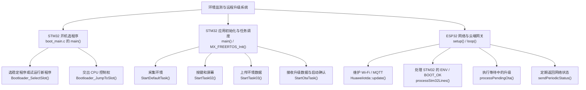
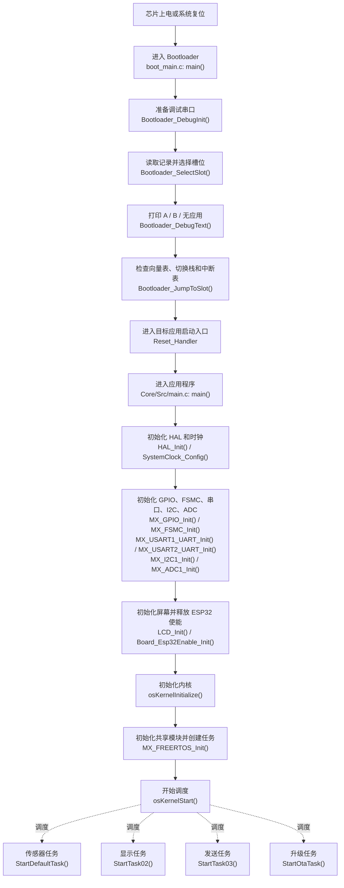
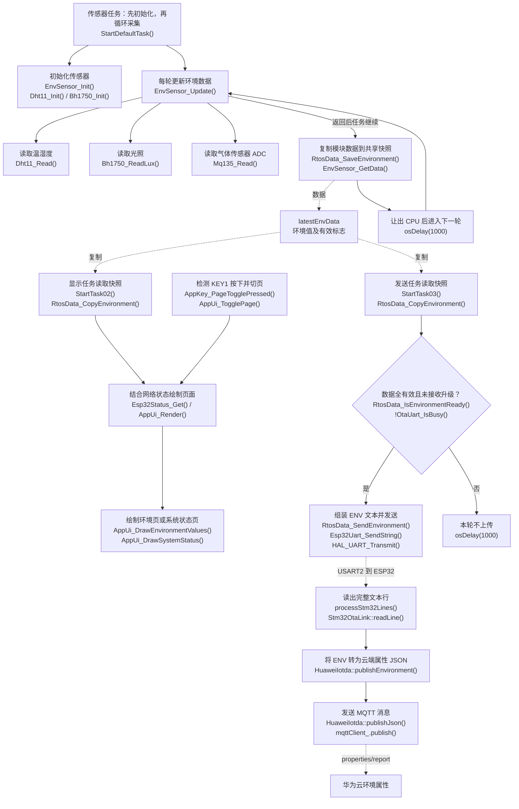
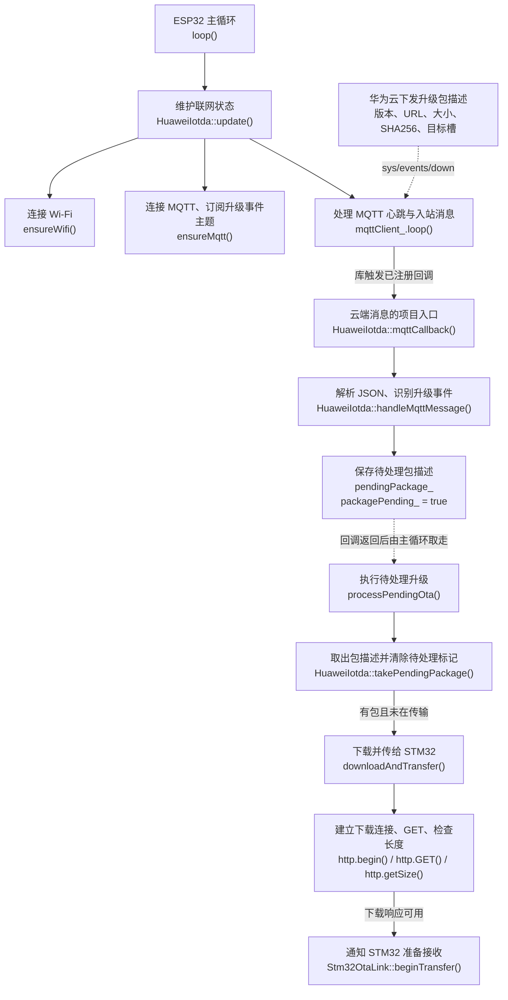
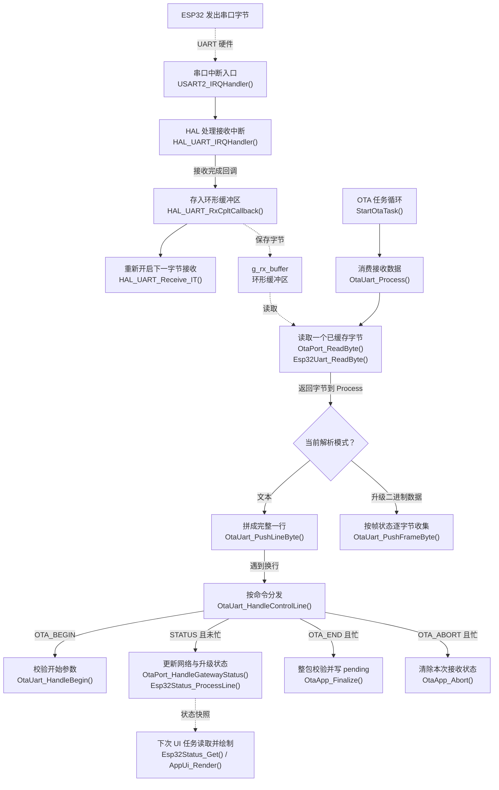
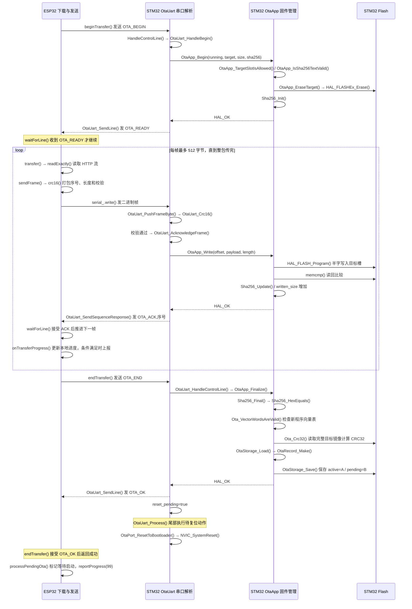
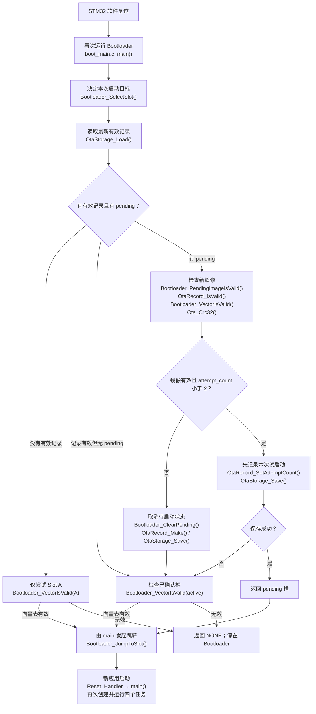
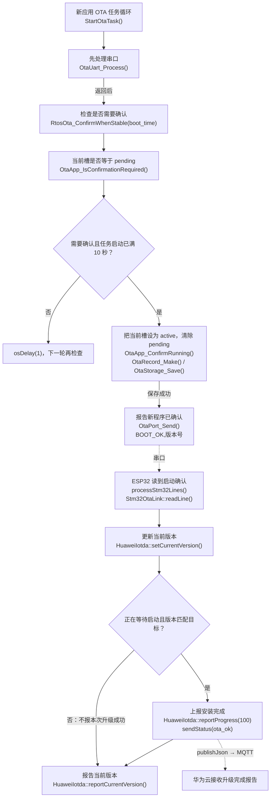
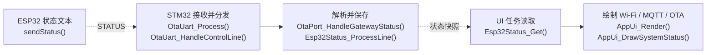

# 整个程序怎样运行：正常运行与华为云 OTA 函数调用图

依据：2026-09-17 当前工作区源码。以下是静态调用关系和控制流程解释，不代表已完成联网或硬件实测。示例以当前运行 Slot A、升级到 Slot B 为主；反向升级的过程相同。

## 阅读图的方法

- 节点第一行讲“在干什么”，下一行给真实函数名。
- 实线箭头表示图中标注的调用或先后处理顺序；不能把所有先后关系理解成前一个函数直接调用后一个函数。
- 虚线箭头表示串口/MQTT 消息、共享数据或任务调度；两端不是普通 C 函数调用。
- Bootloader 的 main 与应用 main 属于两个独立程序。ESP32 的 setup/loop 又运行在另一颗芯片上。
- FreeRTOS 四个任务由调度器轮流执行；传感器任务不会直接调用 UI 任务。

## 图 1：整个工程的职责地图

## 图 2：STM32 从上电到四个任务运行

以下为主要执行顺序。启动文件的 Reset_Handler 完成启动流程后进入各自 main。

`MX_FREERTOS_Init()` 先清空 latestEnvData，再调用 `Esp32Status_Init()`、`Esp32Uart_Init()`、`OtaApp_Init()`、`OtaUart_Init(OTA_APPLICATION_SLOT)`，随后用 `osThreadNew()` 创建四个任务。`RtosTasks_AreCreated()` 检查句柄；失败则进入 `Error_Handler()`。

`Esp32Uart_Init()` 调用 `HAL_UART_Receive_IT()` 开始接收字节，所以真正开始收串口并不需要等到升级指令到来。

`LCD_Init()` 内依次调用 `MX_FSMC_Init()`、`LCD_Reset()`、`LCD_BGOn()`、`LCD_RegConfig()`。应用 main 中的 while(1) 不是日常业务循环；内核成功启动后，业务在任务中执行。

## 图 3：正常采样、显示和上传是怎么连起来的

循环末尾的延时分别为传感器任务 1000 tick、UI 任务 500 tick、发送任务 1000 tick、OTA 任务 1 tick。当前 tick 为 1 ms；实际每轮时间还包含采集、绘图、等待和调度耗时，不是严格的定时采样周期。

UI 任务初次运行会调用 `AppKey_Init()`、`AppUi_Init()`。它根据快照变化局部刷新，而非每次都清屏。传感器数据通过临界区内的结构体复制共享，绘图和发送在临界区外执行。MQ135 当前显示的是未标定估算值。

## 图 4：华为云下发指令，究竟谁先接收

ESP32 的 `setup()` 调用 `stm32Link.begin()`、`huawei.begin()`；后者通过 `setCallback(HuaweiIotda::mqttCallback)` 注册回调。

这里云端先发的是“升级通知及下载信息”，并不是把整份 bin 直接塞进 MQTT。固件字节随后由 `downloadAndTransfer()` 获取的 HTTP 流提供。

`handleMqttMessage()` 接受 `$ota` 下的 `firmware_upgrade` / `firmware_upgrade_v2`，提取 version、url、file_size、sign、custom_info 中的 slot。`version_query` 会调用 `reportCurrentVersion()`，不会进入升级。

回调负责登记任务，不直接下载。ESP32 `loop()` 的实际顺序为 `huawei.update()` → `processStm32Lines()` → `processPendingOta()` → `sendPeriodicStatus()`；前一个函数返回后才执行下一个。

## 图 5：STM32 收串口的共同入口

无论 STATUS、OTA_BEGIN、二进制帧还是 OTA_END，都先走这一条通道。中断只缓存；OTA 任务负责解析和写 Flash。

忙状态下，帧边界遇到字符 O 会切换为控制行接收，以识别 OTA_END / OTA_ABORT。STATUS 并不是忙状态解析器普遍支持的控制行，这一点不能从“有 sendStatus 函数”就推断其在整个传输期一定被显示。

## 图 6：开始、逐帧传输、结束的双芯片握手

以下时序图中的 STM32“串口解析层”均通过图 5 的 ISR 缓冲与 OTA 任务通道到达。

为缩短图中标签，HandleControlLine 指 `OtaUart_HandleControlLine()`；transfer、sendFrame、waitForLine 等是 `Stm32OtaLink` 成员函数。

`OtaUart_SendSequenceResponse()` → `OtaUart_SendLine()` → `OtaPort_Send()` → `HAL_UART_Transmit()` 是 ACK/NACK 的具体发送链。`OTA_READY`、`OTA_OK` 也使用同一行发送路径。

每帧 CRC16 检查串口数据；整包 SHA256 检查接收内容与通知摘要；Flash 中计算的 CRC32 被保存为 pending_crc32，供下次 Bootloader 复查。这里 SHA256 摘要比较不是公钥数字签名验证。

## 图 7：复位后为什么能进入新固件

“尝试两次”按复位后进入 Bootloader 的次数记账。并非到了十秒就由 Bootloader 自动抢回 CPU。若新程序卡死且没有看门狗或外部复位，Bootloader 不会自行再次运行。

## 图 8：新应用确认，云端才收到 100%

当前“稳定”判据只是：当前槽为 pending、OTA 任务运行到十秒检查点、元数据确认写入成功。没有逐一检查传感器、Wi-Fi 和每个任务是否健康。保存失败不会设置 confirmed=true，任务后面会继续尝试。

`BOOT_OK` 的发送使用 `OtaPort_Send()`，没有应用层确认重发；设备确认成功和云端成功收到报告仍是两件事。

## 状态怎样回到 LCD

`sendPeriodicStatus()` 每到两秒阈值调用 `sendStatus()`；另有开始、进度和结果路径主动调用它。

该图描述 STATUS 被成功接收、且解析器处于可处理 STATUS 状态时的路径。下载期间 `processPendingOta()` 同步占用 ESP32 loop；`transfer()` / `waitForLine()` 内没有调用 `huawei.update()`，因此不能画成下载时主循环仍持续执行 MQTT 保活。进度回调会发送 STATUS，但 STM32 忙状态并不正常分发 STATUS；当前 LCD 进度不应被描述成保证连续实时更新。

## 关键辅助函数在做什么

| 所在模块 | 函数组 | 作用与主线位置 |
|---|---|---|
| DHT11 | Dht11_SetOutput / Dht11_SetInput / Dht11_DelayUs / Dht11_WaitFor / Dht11_CyclesPerUs | 为 Dht11_Read 提供引脚方向切换、微秒时序和电平等待 |
| BH1750 | Bh1750_Init / Bh1750_ReadLux | 分别发送初始化命令、通过 HAL_I2C_Master_Receive 读取并换算光照 |
| MQ135 | Mq135_Read | HAL_ADC_Start → HAL_ADC_PollForConversion → HAL_ADC_GetValue → HAL_ADC_Stop |
| UI 固定布局 | AppUi_DrawEnvironmentLayout / AppUi_DrawSystemStatusPage | 在首次进入或切页时绘制固定内容 |
| UI 绘制辅助 | AppUi_DrawHeader / AppUi_DrawFooter / AppUi_DrawCard / AppUi_DrawDashboardStatus / AppUi_DrawProgressBar | 绘制标题、底部提示、卡片、网络摘要和进度 |
| UI 数值辅助 | AppUi_FormatTemperature / AppUi_WriteValueOrNoData / AppUi_WriteCardValue | 格式化温度，根据 valid 决定显示数值或 NO DATA |
| UI 底层桥接 | AppUi_FillRect / AppUi_WriteText | 转成 LCD_SetArea、LCD_WriteCmd、LCD_WriteData 和 LCD_WriteAsciiString |
| LCD 文本 | LCD_WriteAsciiString / LCD_WriteAsciiChar | 字符串拆成字符，按字库写像素 |
| LCD 图形 | LCD_ClearAll / LCD_DrawRectangle / LCD_DrawLine / LCD_DrawPoint | 页面清屏与框线像素绘制；最终通过 FSMC 地址写屏 |
| 串口帧辅助 | OtaUart_ResetFrame / OtaUart_WriteLe16 / OtaUart_Crc16 | 重置帧接收状态、小端编码、计算 CRC16 |
| 串口参数检查 | OtaUart_VersionIsSafe / OtaUart_NormalizeSha256 | 校验版本字符、检查并统一 SHA256 大小写 |
| 串口状态 | OtaUart_SetMessage / OtaUart_IsBusy | 保存接收层状态、供上传任务判断是否暂停 ENV |
| SHA256 | Sha256_Init / Sha256_Update / Sha256_Final / Sha256_HexEquals | 开始摘要、逐帧累计、得出整包摘要、比较目标值 |
| SHA256 内部 | Sha256_ProcessBlock / Sha256_RotateRight | 64 字节块压缩和位运算，服务上述摘要函数 |
| 记录构造 | OtaRecord_Make / OtaRecord_SetAttemptCount | 生成记录或修改次数，并重新计算记录 CRC |
| 记录检查 | OtaRecord_IsValid / OtaRecord_IsApplicationSlot / OtaRecord_CalculateCrc | 字段组合、槽位、记录 CRC 检查 |
| 记录选择 | OtaRecord_SelectNewest | 从两个有效副本中选新记录；由 Load 和 Save 使用 |
| Flash 记录 | OtaStorage_RecordAt / OtaStorage_ProgramRecord | 把地址解释成记录、按半字写入记录；服务 Load/Save |
| 完整性 | Ota_ImageSizeIsValid / Ota_VectorWordsAreValid / Ota_Crc32 | 镜像大小、启动入口和栈范围、镜像或记录 CRC |
| 网关错误 | Stm32OtaLink::lastErrorText / otaResultCodeForFailure | 取得失败点并映射云端结果码，由 processPendingOta 上报 |
| 网关状态读取 | HuaweiIotda::wifiConnected / mqttConnected / lastPublishOk | sendStatus 获取联网和上报状态 |

## 三个成功回执的区别

| 消息 | 谁发出 | 真正含义 |
|---|---|---|
| OTA_ACK,n | 旧应用中的串口解析层 | 第 n 帧已被接受并写入目标槽 |
| OTA_OK | 旧应用中的串口解析层 | 整包校验成功，pending 已保存，即将复位 |
| BOOT_OK,version | 新应用中的 OTA 任务 | 新槽已完成当前代码的十秒确认并设为 active |

ESP32 只有在“正在等待启动，且 BOOT_OK 版本等于本次目标版本”时才发送本次 100% 报告。

## 失败路径和源码注释容易误导的地方

1. 帧 CRC 错误或序号/Flash 写入不符合条件：STM32 发 OTA_NACK；ESP32 同一帧最多发送三次（包含第一次）。超过次数，transfer 返回失败，downloadAndTransfer 调用 abort 发送 OTA_ABORT。
2. ACK 丢失不等于可以无条件恢复：STM32 已推进序号后，重发旧帧会因序号不同收到 NACK，当前接收端没有重复帧重新 ACK 的逻辑。
3. OtaApp_Finalize 失败：返回 OTA_ERROR,verify，不启动新槽。旧 active 保留。
4. Bootloader 校验 pending 失败或两次试启动用尽：清 pending，尝试原 active；原 active 也无效则停机。清 pending 的保存结果目前被忽略。
5. ota_cloud.c 中的 OtaCloud_ParseEvent 虽在工程文件清单中，但当前 Arduino 网关主线不调用它。真正解析云端 JSON 的是 ESP32 的 HuaweiIotda::handleMqttMessage，不能因文件名把接收入口画错。
6. OtaRecord_BootSlot 是纯状态辅助函数；当前 Bootloader 实际选择路径是 Bootloader_SelectSlot。
7. 当前复位链是 OtaPort_ResetToBootloader，不是另一个存在的 OtaApp_ResetToBootloader。测试辅助 OtaUart_BuildFrameForTest / OtaUart_FrameIsValidForTest 也不属于设备正常接收路径。
8. app_ui.c 还留有“未来创建 OTA 任务”的旧注释，但 freertos.c 已实际创建 StartOtaTask；图以执行代码为准。
9. boot_main.c 注释称 CRC32 由云端提供，但执行代码中 pending_crc32 来自 OtaApp_Finalize 对目标 Flash 的计算。
10. OTA_UART 接收缓冲区为 256 字节，固件帧负载最多 512 字节；其正常工作依靠任务持续消费，并非整帧一次装进环形缓冲区。本文不把静态流程核对当成吞吐或掉电测试。

## 对照源码阅读顺序

1. `Core/Src/main.c`：应用的初始化顺序。
2. `Core/Src/freertos.c`：四任务及 RtosData / RtosOta 辅助函数。
3. `Core/Src/env_sensor.c`、`app_ui.c`、`esp32_uart.c`、`esp32_status.c`：日常数据路径。
4. `portable_ota/esp32c3_arduino_gateway/esp32c3_ota_gateway/huawei_iotda.cpp`：云端指令入口。
5. 同目录 `esp32c3_ota_gateway.ino`：主循环、下载升级事务、启动确认上报。
6. 同目录 `stm32_ota_link.cpp`：开始、帧传输和结束握手。
7. `user/OTA/Src/ota_uart.c`：STM32 串口协议分发。
8. `user/OTA/Src/ota_app.c`：擦除、写入、整包验证和确认。
9. `user/OTA/Src/ota_storage.c`、`ota_metadata.c`、`ota_integrity.c`、`sha256.c`：持久化与完整性支持。
10. `portable_ota/stm32/stm32f103_example/bootloader/boot_main.c`：复位后的槽位选择和跳转。

上面 Core、user 路径以 huanjing_HAL 为基准，portable_ota 以工作区根目录为基准。Bootloader 工程引用 portable_ota/stm32/ota_core 支持文件；应用工程引用 huanjing_HAL/user/OTA。此图以读取到的实现为准，不更改固件代码。
